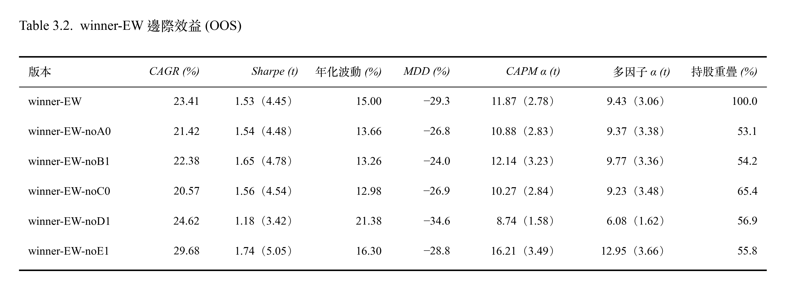
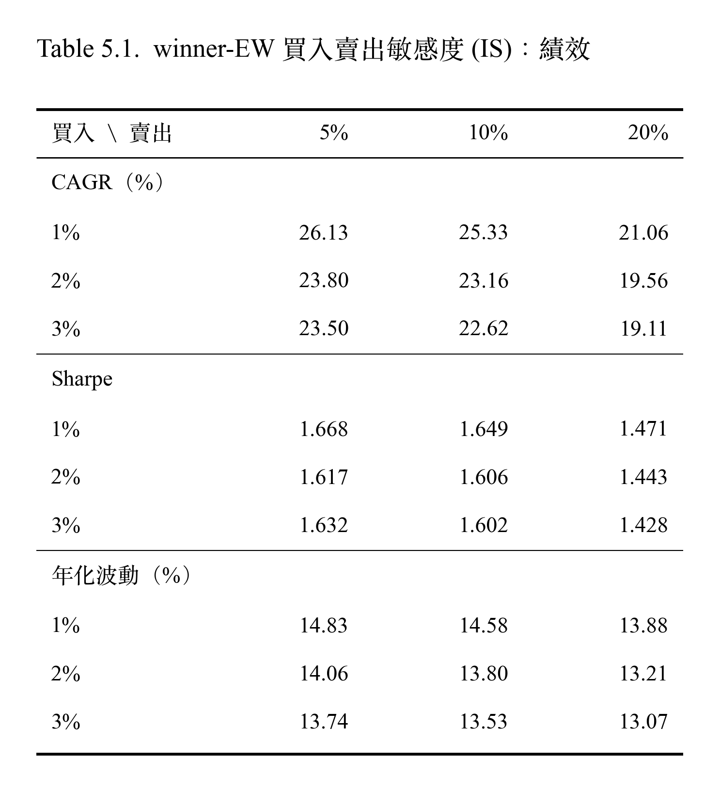
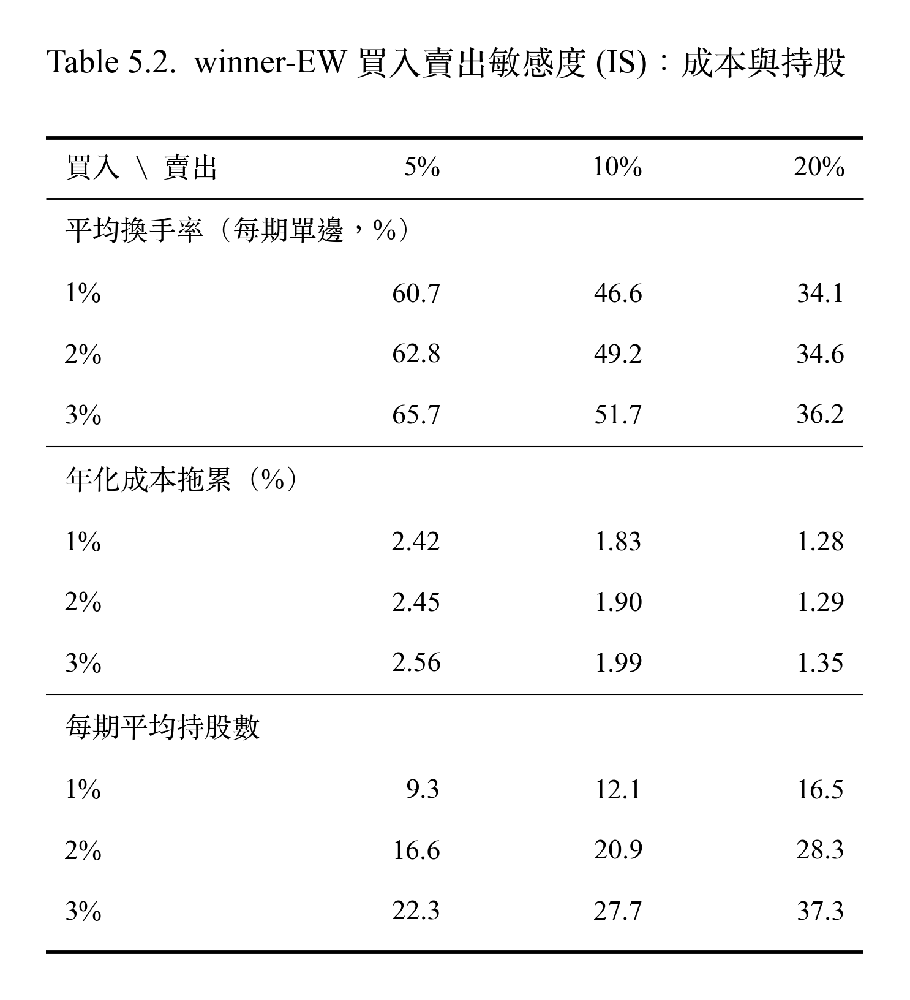

# 策略敏感度調整

## Overview

## 1. 因子預測力

**使用累積 Rank IC，回答問題**

  

> Rank IC 以下期毛報酬計算（不含交易成本）；E0 與 E1 互為鏡像

#### 解讀
- 多數因子在 OOS 仍有正的預測能力。獲利（A0）、價值（B1）、動能（C0）、風險（D1）等勝者因子，累積 IC 在 OOS 持續上升，但是斜率比 IS 平緩。預測能力減弱，與平均 IC 解讀一致。
- B0 的斜率在 OOS 變陡，PB 出現微弱預測力。
- C1 在兩個期間都幾乎持平，幾乎沒有預測力。
- E0、E1 規模因子在 IS 沒有方向，OOS 轉為大型股較佳。
- **2025 到 2026 年多個因子同時轉弱**（由圖觀察）：殘差 PB（B1）、低 beta（D0）、低波動度（D1）的累積 IC 轉為下降，規模往大型股方向加速。推論，未經驗證：這段期間由大型高市值股主導，與價值、低風險、小型股方向相反。這與策略在 2024 年中以後資金累積持平、股票池落後大盤的解讀一致。準確時間點請見 [5.1 三年窗口滾動多因子曝險分析](03_Backtesting.md#51-三年窗口滾動多因子曝險分析)。

---

### 2. 因子邊際效益

**從 winner-EW 5 個因子拿掉一個，策略會變好還是變差？**
- 每次拿掉 1 個因子，其餘 4 個仍然排名等權相加

  

  

#### 推論
- D1 低波動
  - 在 IS 中，多因子 α 幾乎歸零，Sharpe 降到 1.10 且最大回撤加深到 -29.7%。表示低波動是 IS 當中 α 主要來源。
  - 在 OOS 中，雖然 CAGR 有上升比完整版高 (24.62% 對 23.41%)，但是 Sharpe 只有 1.18。表示移除低波動因子，波動大很多，同時最大回撤也降至 34.6%。
  - 表示 D1 的作用在於控制風險，而不是提高報酬。 
- 拿掉 E1 在兩段中每期報酬、CAPM α、多因子 α 都上升，都可以提升績效表現。Sharpe 上升幅度是 6 個版本中最大的(Sharpe IS 1.8, Sharpe OOS 1.74)。
- 換手率拿掉 A0、B1、C0 下降；而拿掉 D1、E1 上升。拿掉任何一個因子，持股重疊只有 53%-69%，因此現在的買賣規則，排名邊界對於因子組成非常敏感，拿掉一個因子就會改變將近一半的持股。

## 3. 股票池敏感度

**策略為含 E1 的 winner-EW（A0、B1、C0、D1、E1），不是現行的 noE1。**

| 股票池 | CAGR (%) | Sharpe | 年化波動 (%) | 每期平均單邊換手率 (%) | 年化成本拖累 (%) | 每期持股數（中位數） |
|---|---|---|---|---|---|---|
| 市值前 30% | 24.73 | 1.613 | 14.61 | 50.74 | 1.99 | 12 |
| 市值前 50% | 23.16 | 1.606 | 13.80 | 49.22 | 1.90 | 21 |
| 市值前 70% | 27.72 | 1.870 | 13.83 | 52.97 | 2.13 | 27 |
| 流動性前 30% | 26.30 | 1.213 | 21.50 | 70.21 | 2.80 | 10.5 |
| 流動性前 50% | 28.33 | 1.504 | 17.95 | 61.98 | 2.51 | 19 |
| 流動性前 70% | 31.45 | 1.816 | 16.04 | 57.29 | 2.37 | 26 |
| 市值前 50% + 均線 30 日 | 23.22 | 1.525 | 14.65 | 63.66 | 2.48 | 17 |
| 市值前 50% + 均線 60 日 | 23.56 | 1.571 | 14.36 | 60.90 | 2.37 | 18 |
| 市值前 50% + 均線 120 日 | 23.45 | 1.579 | 14.22 | 56.66 | 2.20 | 19 |

> 每格為 IS 。IS 為第 13–46 期（34 期）。CAGR、Sharpe、年化波動皆為扣成本後，由每日淨值計算。
>
> 在原本的 2%/10% 交易規則之上，加上換股日買入均線之上的股票，買入依照排名遞補，賣出跌破均線的股票
> 交易規則：買進合成排名前 2%，跌出前 10% 或離開股票池才賣；季換股；持股等權。
>
> 流動性 = 成交量 × 收盤價，取換股前 20 個交易日的中位數。市值、流動性的 6 個股票池各自在池內重算因子排名；均線 3 列沿用市值前 50% 的排名。
>

## 4. 買入賣出門檻敏感度 M15

**winner-EW 的績效結果是否隨買入、賣出門檻平滑變化？每期要換手多少股票？每年交易成本吃掉多少報酬？**
- 基準: 2%/10% 為目前實驗設定
- 策略: winner-EW （A0、B1、C0、D1、E1） 五因子排名等權；季換股；持股等權
- 成本: 手續費 0.1425%（雙邊）、證交稅 0.3%（賣出）、滑價 0.1%（雙邊）

  

  

> 每期單邊換手率 =（買進金額 + 賣出金額）÷ 2 ÷ 換股前淨值
>
> 年化成本拖累 = 毛 CAGR - 淨 CAGR ≈ 年化成本 × (1 + 複利/年報酬率)，說明成本讓年化報酬少了多少，可以直接和年化報酬比較

### 解讀
- 換手率、成本拖累，隨著買入門檻調高變大，隨著賣出門檻調高變低。持股數隨買入、賣出門檻調高皆變大。
- 賣出門檻 5% 和 10% 表現差不多（IS 中 5% 報酬表現略好；OOS 中 10% 報酬表現較好）。
- 賣出門檻放寬到 20%、30%，報酬都下降（相對於賣出 10% 門檻，IS 下降 1.7–6.3 個百分點；OOS 下降 0.4-5.9 個百分點）。雖然換手率跟年化成本拖累都較低，但是省下的成本補不回報酬的損失。
  - 賣出緩衝區的作用是降低換手率與成本。但是放寬到 20% 以上時，損失的報酬多於省下的成本。且 5% 與 10% 在兩期間差異不顯著，專案設定維持目前的 10%。
- 買入門檻，報酬在 IS 較不單調無規律。而 OOS 中則隨著買入門檻放寬表現降低 (例如賣出 10% 欄： 28.57%、23.41%、21.99%、20.08%、18.66%)，表現單調遞減。
  - 買入門檻 IS 中看不出規律，但是 OOS 中卻很清楚，最頂端的股票最有效。但同時，1% 因為每期持股數最少（12-14 檔），年化波動較高（IS 14.58%、OOS 16.48%）。
- 在 OOS 中所有格的波動都低於股票池等權（18.4）跟大盤 TRTEJ (19.4)。持股越多波動大致越低。
  - OOS 的波動全部高於 IS，表示 OOS 期間市場波動較大，主要不是門檻與持股差異造成。

## 5. All in One 大禮包

用更多的策略，確認股票池優勢。

說法可以是，只用 IS 結果去調整規則、股票池。 (修表格)
然後股票池就是統一用均線去調整，所以一定是買入賣出一樣。 (修表格)

IS and OOS result
0. 策略: winner-EW / winner-EW-noE1 / winner-EW-noE1-dropB (A0A2 x S_r ) / winner-EW-noE1-dropB (A0A2r x S_r )
1. 買入賣出規則：2%/10%
2. 股票池：市值前 50% / 市值前 70% / 流動性 70% /  市值 70% (60 日均線 + 買入賣出) / 流動性 70% (60 日均線 + 買入賣出)

IS and OOS result
0. 策略: winner-EW / winner-EW-noE1 / winner-EW-noE1-dropB (A0A2 x S_r ) / winner-EW-noE1-dropB (A0A2r x S_r )
1. 買入賣出規則： 1%/10%
2. 股票池：市值前 50% / 市值前 70% / 流動性 70% /  市值 70% (60 日均線 + 買入賣出) / 流動性 70% (60 日均線 + 買入賣出)

