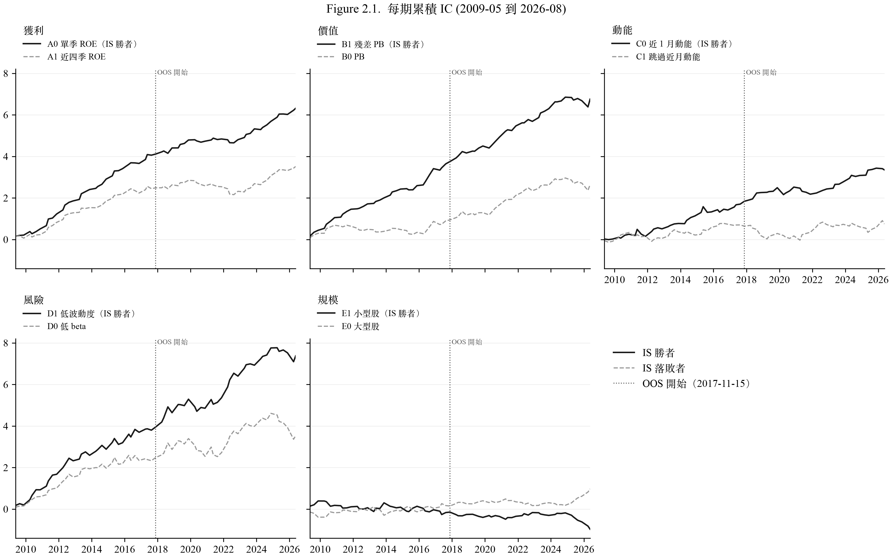
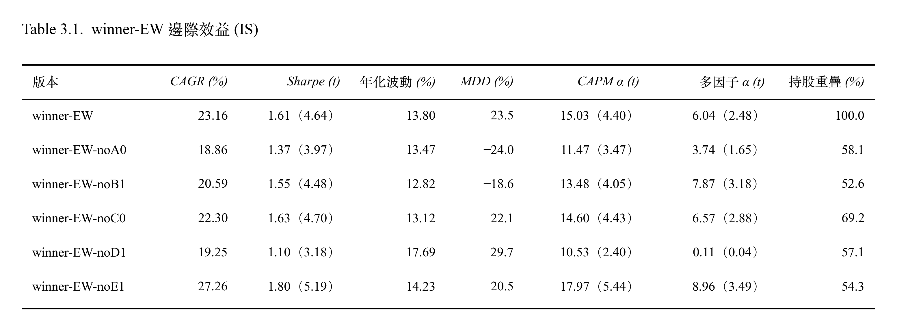
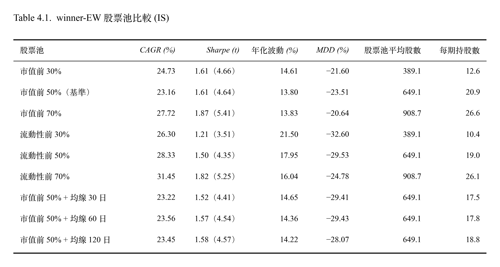

# 策略改良調整

## 1. Overview


## 2. 因子預測力

**因子的預測力是穩定的，還是在某些時期開始失效？**
- 每期 IC 累積相加，斜率等於平均 IC。斜率向上越陡代表預測力越強；持平代表該段期間沒有預測力；向下代表方向相反。

<p align="center">
  
</p>

#### 解讀
- 獲利、價值、動能、風險等領域勝者因子（A0、B1、C0、D1）在 OOS 累積 IC 持續上升、斜率仍為正，表示仍有預測能力。
- 規模因子在 IS 趨勢持平，沒有穩定的預測力。在 OOS 後期（2025 後）轉為大型股（E0）較佳。
- B0 的斜率在 OOS 些微上升，出現微弱預測力。C1 在兩個期間都幾乎持平，沒有展現出預測力。
- 2025 到 2026 年多個因子同時轉弱：B0、B1、D0、D1、E1 的累積 IC 斜率轉為下降。推論：這段期間便宜、低波動、小型股預測能力同時失效，目前期數少，無法判斷是短期反轉還是長期市場轉變。


## 3. 因子邊際效益

**IS 期間，從 winner-EW 策略 5 個因子拿掉一個，新版本策略的報酬、風險、α 會變好還是變差？**
- 每次拿掉 1 個因子，其餘 4 個排名等權相加。因子權重從 1/5 變成 1/4。

<p align="center">
  
</p>

> 多因子回歸（衡量 α 與曝險）使用同一組解釋變數：市場（TRTEJ）加上 A0、B1、C0、D1、E1 共 5 個風格因子
> 
> 持股重疊：和 winner-EW 的持股重疊比例

#### 解讀
- 拿掉 A0：Sharpe 降到 1.37、多因子 α 降到 3.74%（t 1.65）。
- 拿掉 D1：Sharpe 降到 1.10、多因子 α 降到 0.11%（t 0.04）。移除低波動因子 D1 後，該版本策略幾乎沒有 α。
- 拿掉 B1：波動與回撤都有改善（12.82%、−18.6%），但是 CAGR 報酬降低為 20.59%。
- 拿掉 E1：CAGR 報酬 (27.26%)、Sharpe (1.80, t 5.19)、多因子 α (8.96%, t 3.49)，優於原策略。
- 持股重疊只有約 53%–69%，表示拿掉 1 個因子就會換掉將近一半的持股，不同版本與 winner-EW 間的差異相當於換了一批持股。

```
💡 winner-EW-noE1 於 IS 認定為較優的策略。
```


## 4. 股票池比較

**IS 期間，winner-EW 如果換一個股票池（市值範圍大小、改用流動性篩選、或加上均線條件），績效會不會不同？**
- 原始設定基準是市值前 50%，排除金融股。

<p align="center">
  
</p>

> 個股流動性 = 成交量 × 收盤價，取換股前 20 個交易日的中位數。
>
> 均線交易規則：換股日檢查，在原本的 2% 買入/10% 賣出交易規則之上，只買入均線之上的股票（不符合則依照排名往後遞補）；賣出跌破均線的股票。


#### 解讀
- 換手率決定成本拖累。
- 流動性池換手率高的原因：20 日成交金額每季變動大，股票常在邊界進進出出。流動性池報酬較高，但他們的波動也明顯較高，所以 Sharpe 反而較低。
- 流動性前 30% 的股票波動高達 21.50%、MDD -32.60%。表示成交金額大的股票往往是高波動的股票，低波動 D1 已無法發揮作用。這和市值前 30% (波動 14.61%) 差別很大。說明流動性和市值，選出的是不一樣的股票。
- 流動性股票池每季換得比較兇，成交金額每季的變動比市值大，舊持股比較留不住。因此每季持股較容易掉出 10% 邊界。
- 持股越少波動越高，會讓持股過度集中
- 均線沒有帶來改善
- IS 中最有效率的是市值 70% (CAGR 27.72%, Sharpe 1.87) 跟流動性 70% (CAGR 31.45%, Sharpe 1.82)。

```
💡 均線與回撤

MDD 是由單一事件決定，而 IS 期間所有股票池版本的 MDD 均發生在 2011-08-15 這次換股。換股日賣出下跌超過均線的股票，而換入下一批前一波還沒跌的股票，後來補跌得最重。推論，均線不是停損條件，對於換股日之前的急跌無法避開。

```


## 5. 買入賣出門檻敏感度 M15

**winner-EW 的績效結果是否隨買入、賣出門檻平滑變化？每期要換手多少股票？每年交易成本吃掉多少報酬？**
- 基準: 2%/10% 為目前實驗設定
- 策略: winner-EW （A0、B1、C0、D1、E1） 五因子排名等權；季換股；持股等權
- 成本: 手續費 0.1425%（雙邊）、證交稅 0.3%（賣出）、滑價 0.1%（雙邊）

<p align="center">
  
</p>

<p align="center">
  
</p>

> 每期單邊換手率 =（買進金額 + 賣出金額）÷ 2 ÷ 換股前淨值
>
> 年化成本拖累 = 毛 CAGR - 淨 CAGR ≈ 年化成本 × (1 + 複利/年報酬率)，說明成本讓年化報酬少了多少，可以直接和年化報酬比較

#### 解讀
- 換手率、成本拖累，隨著買入門檻調高變大，隨著賣出門檻調高變低。持股數隨買入、賣出門檻調高皆變大。
- 賣出門檻 5% 和 10% 表現差不多（IS 中 5% 報酬表現略好；OOS 中 10% 報酬表現較好）。
- 賣出門檻放寬到 20%、30%，報酬都下降（相對於賣出 10% 門檻，IS 下降 1.7–6.3 個百分點；OOS 下降 0.4-5.9 個百分點）。雖然換手率跟年化成本拖累都較低，但是省下的成本補不回報酬的損失。
  - 賣出緩衝區的作用是降低換手率與成本。但是放寬到 20% 以上時，損失的報酬多於省下的成本。且 5% 與 10% 在兩期間差異不顯著，專案設定維持目前的 10%。
- 買入門檻，報酬在 IS 較不單調無規律。而 OOS 中則隨著買入門檻放寬表現降低 (例如賣出 10% 欄： 28.57%、23.41%、21.99%、20.08%、18.66%)，表現單調遞減。
  - 買入門檻 IS 中看不出規律，但是 OOS 中卻很清楚，最頂端的股票最有效。但同時，1% 因為每期持股數最少（12-14 檔），年化波動較高（IS 14.58%、OOS 16.48%）。
- 在 OOS 中所有格的波動都低於股票池等權（18.4）跟大盤 TRTEJ (19.4)。持股越多波動大致越低。
  - OOS 的波動全部高於 IS，表示 OOS 期間市場波動較大，主要不是門檻與持股差異造成。

## 5. All in One 大禮包

用更多的策略，確認股票池優勢。

說法可以是，只用 IS 結果去調整規則、股票池。 (修表格)
然後股票池就是統一用均線去調整，所以一定是買入賣出一樣。 (修表格)

IS/OOS result (2%/10%)
0. 策略: winner-EW (CAGR(%), Sharpe(t), 年化波動(%), MDD(%)) / winner-EW-noE1 (CAGR(%), Sharpe(t), 年化波動(%), MDD(%))
2. 股票池：市值前 50% / 市值前 70% / 流動性 70% /  市值 70% (60 日均線 + 買入賣出) / 流動性 70% (60 日均線 + 買入賣出)


IS/OOS result (1%/10%)
0. 策略: winner-EW / winner-EW-noE1 / winner-EW-noE1-dropB (A0A2 x S_r ) / winner-EW-noE1-dropB (A0A2r x S_r )
1. 買入賣出規則： 1%/10%
2. 股票池：市值前 50% / 市值前 70% / 流動性 70% /  市值 70% (60 日均線 + 買入賣出) / 流動性 70% (60 日均線 + 買入賣出)


