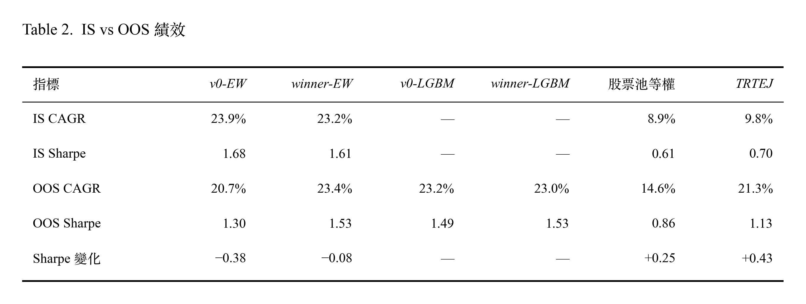
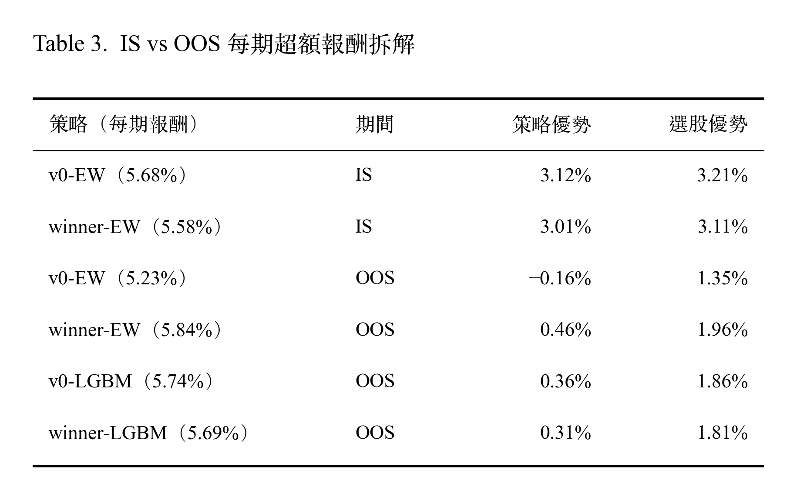
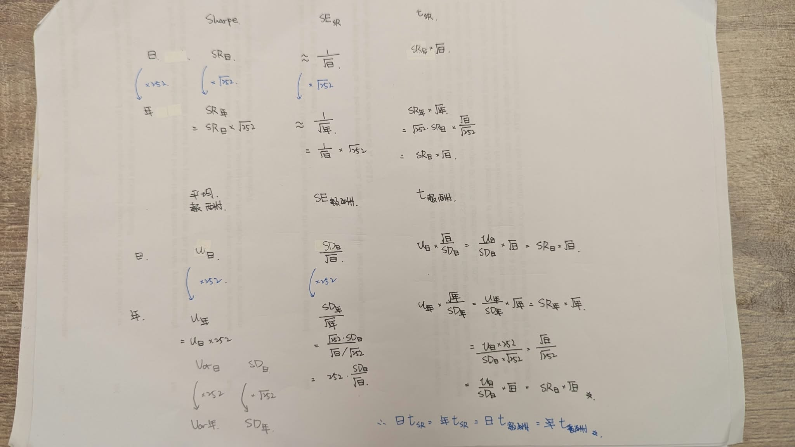
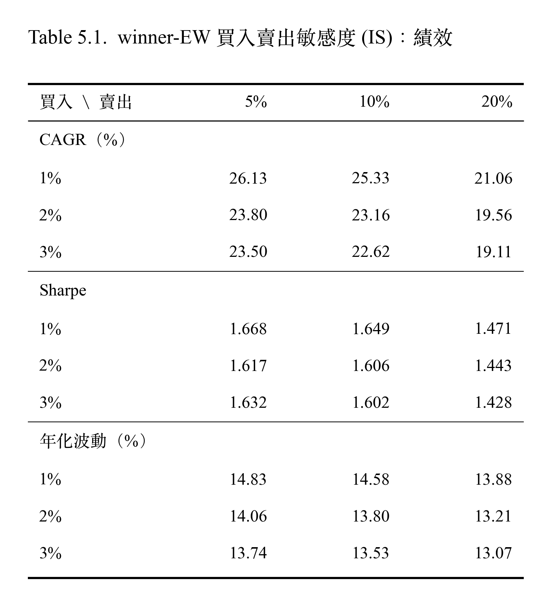
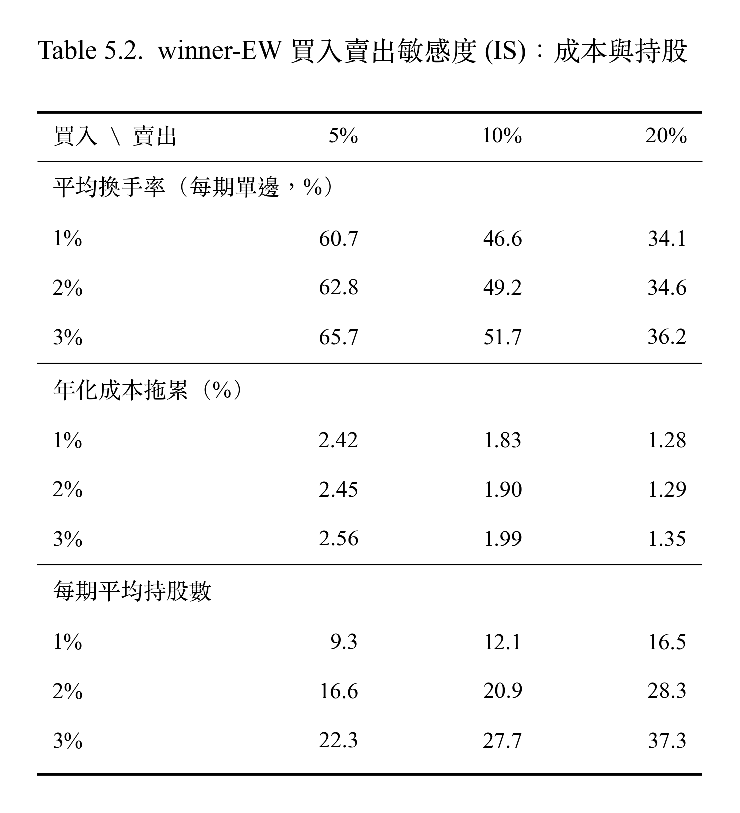

# 策略補充分析

# 只放要講的

## 6. 研究問題

### 6.1 研究問題
```
💡 研究問題

研究問題一：winner vs. v0，依 IS 單因子表現挑選出的變體勝者，OOS 上能否也改善策略？
研究問題二：LGBM vs. EW，用機器學習合成因子，能否勝過簡單的等權合成？
```

| 問題 | 比較 | 平均每期報酬差 | 每期 95% 信賴區間 | 結論 |
|---|---|---|---|---|
| 問題一 | (winner-EW) − (v0-EW) | +0.61%（年化約 +2.4%） | [−1.17%, 2.40%] | 包含 0，不顯著 |
| 問題一 | (winner-LGBM) − (v0-LGBM) | −0.05%（年化約 −0.2%） | [−1.36%, 1.27%] | 包含 0，不顯著 |
| 問題二 | (v0-LGBM) − (v0-EW) | +0.51%（年化約 +2.0%） | [−1.03%, 2.05%] | 包含 0，不顯著 |
| 問題二 | (winner-LGBM) − (winner-EW) | −0.15%（年化約 −0.6%） | [−1.20%, 0.90%] | 包含 0，不顯著 |

#### 解讀
- 因子差異不顯著。以問題一為例，資料仍容許 winner-EW 每期報酬少約 1.17% 到領先約 2.4%。
- LGBM 與等權差異小。推論在少因子數合成上，LGBM 常退化為接近等權的排序。既然沒有偵測到差異，較簡單的等權合成在 5 因子策略的開發、維護成本上較有優勢。

---

### 6.2 真實值與所需樣本估算

<p align="center">
  
</p>

> 要在 5% 顯著水準下有八成的檢定力，真實的 δ 要大約 2.8 倍標準誤

---

### 6.3 OOS 單因子檢定

**相同規則**：OOS 每個領域中，LS 較高的變體勝出。比較因子勝者是否延續到樣本外。

| 領域 | v0 / v1 IC | v0 / v1 LS | OOS LS 勝者 |
|---|---|---|---|
| 獲利 | 0.065 / 0.031 | 2.97% / 0.07% | **A0** |
| 價值 | 0.050 / 0.089 | −0.54% / 1.37% | **B1** |
| 動能 | 0.047 / 0.001 | 3.86% / 2.23% | **C0** |
| 風險 | 0.035 / 0.102 | −4.71% / −2.17% | **D1** |
| 規模 | 0.023 / −0.023 | 2.12% / −2.12% | **E0** |

> IS 勝者：A0、B1、C0、D1、E1

#### 解讀
- 5 個領域中有 4 個的 IS 勝者在 OOS 仍是勝者，只有規模反轉（大型股較佳）。勝負差的信賴區間不包含 0 的只有獲利、價值、風險。規模在 IS 本來就沒有預測力，OOS 的反轉也不顯著。
- D1 依然勝過 D0，顯示低波動度的預測能力在樣本外依然勝過低 beta。兩者 LS 都為負。推論，未經驗證：LS 做多低風險股、做空高風險股，OOS 中帶有負的市場曝險，OOS 為強勢多頭（股票池等權年化 14.6%），而高風險股漲得較多，因此 LS 被拖累。
- 單因子層級的勝負大致延續，但沒有轉化為策略層級的優勢（同問題一）：OOS 中 winner-EW 每期比 v0-EW +0.61%（因子勝者 OOS 上策略績效不顯著勝利）。

```
💡 加入風險因子會降低策略報酬嗎？

專案實驗無法證明「有風險因子」與「沒有風險因子」的報酬差異。需要另外回測檢驗。
```

## 7. IS vs OOS 擬合

### 7.1 IS vs OOS 績效

<p align="center">
  
</p>

> IS：2009-05 到 2017-08（34 期）、OOS：2017-11 到 2026-08（35 期）；
> Sharpe 變化 = OOS Sharpe − IS Sharpe；
> LGBM 沒有 IS 回測，以「—」表示

#### 解讀
- v0-EW 策略的 Sharpe 從 IS 到 OOS 降了 0.38。winner-EW 的 Sharpe 只降了 0.08，年化報酬幾乎不變。推論，勝者因子依然有解釋報酬的能力，進一步分析請看 [6.3 OOS 單因子檢定](#63-oos-單因子檢定) 與 [累積 Rank IC](05_Strategy%20Rework.md#累積-rank-ic)。
- 大盤的 Sharpe 上升。推論：策略相對大盤的優勢，主要是因為大盤變強而縮小，不是策略本身大幅變差。
- winner-EW 在樣本內年化報酬本來沒有勝過 v0-EW（−0.70%），在樣本外反而領先約 2.70%。但是策略層檢定力無法判斷是否過擬合 (以 OOS 35 期來說，5% 顯著水準下要有 80% 機會測試出來，每一期差距至少要 2.5%) ，過擬合證據可參考單因子層級勝者延續 [6.3 OOS 單因子檢定](#63-oos-單因子檢定) 。

---

### 7.2 IS vs OOS 每期超額報酬拆解

拆解方式：
- **`策略優勢`**（每期超額報酬）= 策略 − 大盤
- **`選股優勢`** = 策略 − 股票池等權
- `策略優勢` = `選股優勢` +（股票池等權 − 大盤）
- IS（34 期）每期報酬：股票池等權 = 2.47%；大盤 = 2.56%；股票池等權 − 大盤 = −0.09%
- OOS（35 期）每期報酬：股票池等權 = 3.88%；大盤 = 5.38%；股票池等權 − 大盤 = −1.50%

<p align="center">
  
</p>

> 大盤指的是指數報酬（TRTEJ）；上表皆為每期平均報酬（每期約一季）

#### 解讀
- 策略本身的報酬在 OOS 沒有明顯下降。兩個 EW 策略每期報酬從 IS 的 5.68%、5.58%，變為 OOS 的 5.23%、5.84%。
- 選股優勢從每期約 3% 縮小到 1.35%–1.96%，後續統計說明 OOS 多數因子的 IC 仍為正但轉弱。進一步分析請看 [6.3 OOS 單因子檢定](#63-oos-單因子檢定) 與 [累積 Rank IC](05_Strategy%20Rework.md#累積-rank-ic)。縮小主要來自 E1 風格報酬，參見 [4.3 多因子曝險分析](03_Backtesting.md#43-多因子曝險分析)。
- OOS 大盤強勢。大盤的每期報酬在 OOS 約增加為兩倍（TRTEJ 從 2.56% 升到 5.38%）。而股票池等權只從 2.47% 升到 3.88%，OOS 每期落後大盤 1.50%。
- 策略優勢的縮小，約一半來自選股優勢減弱、約一半來自股票池落後大盤。以 IS 到 OOS 的每期變化計算：
  - v0-EW 的策略優勢減少 3.28 百分點 = 選股優勢減少 1.86（約 57%）+ 股票池相對大盤減少 1.41（約 43%）
  - winner-EW 的策略優勢減少 2.55 百分點 = 選股優勢減少 1.15（約 45%）+ 股票池相對大盤減少 1.41（約 55%）
- 推論，未經驗證：OOS 期間大盤受少數超大型權值股推升，等權的股票池跟不上；這與後續觀察規模因子反轉（大型股較佳）的方向一致。

### 7.3 CAPM 分析

| 期間 | 序列 | β [95% CI] | α 年化（t） |
|---|---|---|---|
| IS | v0-EW | 0.71 [0.68, 0.74] | 15.2%（5.30） |
| IS | winner-EW | 0.67 [0.62, 0.72] | 15.0%（4.40） |
| IS | 股票池等權 | 0.93 [0.89, 0.97] | 0.1%（0.03） |
| OOS | v0-EW | 0.55 [0.49, 0.62] | 8.7%（1.96） |
| OOS | winner-EW | 0.50 [0.44, 0.57] | 11.9%（2.78） |
| OOS | v0-LGBM | 0.50 [0.43, 0.58] | 11.7%（2.65） |
| OOS | winner-LGBM | 0.51 [0.44, 0.57] | 11.5%（2.81） |
| OOS | 股票池等權 | 0.78 [0.74, 0.83] | −1.4%（−0.38） |

> 日淨報酬對 TRTEJ 日報酬迴歸；無風險利率為 0；年化 α = 日 α × 252。
> 範例：winner-EW 的 α = (9.1 bps × 252) − 0.5 × (8.7 bps × 252) ≈ 11.9%

#### 解讀

- 原始報酬持平，風險調整過後為正。OOS 當中 winner-EW 策略優勢（每期策略 − 每期大盤）+0.46% 不顯著；但是 CAPM α 年化 11.9%（t 2.78）
  - 風險調整：原先直接用（策略 − 大盤）等於假設 β = 1，假設策略承擔的市場風險跟大盤一樣多。
  - 但實際回歸後 β = 0.5，在 OOS 強勢多頭中，承擔一半的風險卻取得相近的報酬。
- α 從 IS 到 OOS 變小。可以看到 EW 策略的 α 從原本的約 15% 降到 8.7%–11.9%。從另外一個角度說明了選股優勢降低。
- β 從 IS 到 OOS 變小。可以看到 EW 策略的 β 從原本的約 0.67–0.71 降到 0.50–0.55，股票池等權也從 0.93 降到 0.78，代表整體與大盤的連動變弱。
- IS 和 OOS，股票池等權沒有 α，兩段期間 α 都接近 0，股票池本身只是低一點 β 的大盤。策略的 α 來自因子選股。

## 8. 筆記

### 8.1 日、年 Sharpe Ratio（SR）以及 SE(SR)

<p align="center">
  
</p>

<p align="center">
  
</p>

> 日 SR 的 t ≈ 年 SR 的 t ≈ 日報酬的 t = 年報酬的 t

---

## 9. 因子邊際貢獻

---

## 1. winner-EW 滾動多因子迴歸

**全期平均結果，是否在每一段時間都成立？**
- 使用 1、2、3 年的滾動窗口檢查 α 和曝險是否隨時間改變

| 統計量 | 中位數 | 第 10 百分位 | 第 90 百分位 | 為正的窗口比例 |
|---|---|---|---|---|
| 多因子 α（年化） | 12.2%／12.5%／12.0% | −8.2%／−2.7%／4.4% | 24.0%／20.0%／20.2% | 80%／89%／100% |
| CAPM α（年化） | 15.3%／19.5%／19.1% | −14.0%／−2.6%／7.2% | 33.7%／26.4%／25.4% | 83%／89%／96% |
| β TRTEJ | 0.52／0.55／0.56 | 0.43／0.46／0.46 | 0.71／0.73／0.65 | 100%／100%／100% |
| β A0 獲利 | 0.03／0.02／0.01 | −0.04／−0.04／−0.04 | 0.14／0.12／0.09 | 78%／70%／51% |
| β B1 價值 | 0.25／0.34／0.31 | 0.11／0.16／0.27 | 0.44／0.37／0.34 | 100%／100%／100% |
| β C0 動能 | 0.12／0.16／0.16 | 0.04／0.08／0.11 | 0.22／0.20／0.19 | 96%／100%／100% |
| β D1 低波動 | −0.16／−0.20／−0.20 | −0.31／−0.25／−0.23 | −0.09／−0.12／−0.14 | 0%／0%／0% |
| β E1 小型股 | 0.52／0.58／0.54 | 0.30／0.43／0.46 | 0.67／0.66／0.62 | 100%／100%／100% |
> 各窗口長度依序為 1 年／2 年／3 年。

#### 解讀
- CAPM α 在三種窗口的中位數都大於多因子 α。
- 多因子 α 的中位數在三種滾動窗口下都約為 12%，且在多數窗口為正。說明全期 α 不是由單一期間造成。
- 策略的風格輪廓穩定，策略一直都是約一半的市場曝險、偏小型股、價值、動能、相對偏高波動。
  - 穩定曝險：市場、B1、C0、E1 在所有窗口大部分都為正曝險；D1 在所有窗口都為負。
  - 不穩定曝險：獲利 A0 的 β 中位數接近 0，策略走勢幾乎不被獲利因子影響。為正的比例隨著窗口變長而下降，估計窗口越長越接近真實值，3 年窗口剛好一半為正。
- 使用三年窗口的原因是雜訊較少，曲線較平滑。要看的是 α 的長期趨勢，不是即時偵測轉變。


## 3. 買入賣出門檻 M15

**winner-EW 的績效結果是否隨買入、賣出門檻平滑變化？每期要換手多少股票？每年交易成本吃掉多少報酬？**
- 基準: 2%/10% 為目前實驗設定
- 策略: winner-EW （A0、B1、C0、D1、E1） 五因子排名等權；季換股；持股等權
- 成本: 手續費 0.1425%（雙邊）、證交稅 0.3%（賣出）、滑價 0.1%（雙邊）

<p align="center">
  
</p>

<p align="center">
  
</p>

> 每期單邊換手率 =（買進金額 + 賣出金額）÷ 2 ÷ 換股前淨值
>
> 年化成本拖累 = 毛 CAGR - 淨 CAGR ≈ 年化成本 × (1 + 複利/年報酬率)，說明成本讓年化報酬少了多少，可以直接和年化報酬比較

### 解讀
- 換手率、成本拖累，隨著買入門檻調高變大，隨著賣出門檻調高變低。持股數隨買入、賣出門檻調高皆變大。
- 賣出門檻 5% 和 10% 表現差不多（IS 中 5% 報酬表現略好；OOS 中 10% 報酬表現較好）。
- 賣出門檻放寬到 20%、30%，報酬都下降（相對於賣出 10% 門檻，IS 下降 1.7–6.3 個百分點；OOS 下降 0.4-5.9 個百分點）。雖然換手率跟年化成本拖累都較低，但是省下的成本補不回報酬的損失。
  - 賣出緩衝區的作用是降低換手率與成本。但是放寬到 20% 以上時，損失的報酬多於省下的成本。且 5% 與 10% 在兩期間差異不顯著，專案設定維持目前的 10%。
- 買入門檻，報酬在 IS 較不單調無規律。而 OOS 中則隨著買入門檻放寬表現降低 (例如賣出 10% 欄： 28.57%、23.41%、21.99%、20.08%、18.66%)，表現單調遞減。
  - 買入門檻 IS 中看不出規律，但是 OOS 中卻很清楚，最頂端的股票最有效。但同時，1% 因為每期持股數最少（12-14 檔），年化波動較高（IS 14.58%、OOS 16.48%）。
- 在 OOS 中所有格的波動都低於股票池等權（18.4）跟大盤 TRTEJ (19.4)。持股越多波動大致越低。
  - OOS 的波動全部高於 IS，表示 OOS 期間市場波動較大，主要不是門檻與持股差異造成。


## 4. 股票池敏感度 M19

## 7. 持股權重分析 M10

對象：winner-EW-noE1：A0、B1、C0、D1 排名等權相加；買前 2%、跌出前 10% 才賣；季換股
實驗：
  - 等權（基準）
  - sqrtcap：√市值
  - scorecap：分數 × 市值
  - cap：市值


**OOS**

| 指標 | 等權 | sqrtcap | scorecap | cap |
|---|---|---|---|---|
| CAGR | 29.68% | 29.38% | 29.13% | 29.28% |
| 算術年化平均 | 28.29% | 28.13% | 27.99% | 28.11% |
| 年化波動 | 16.30% | 16.83% | 17.13% | 17.15% |
| Sharpe | **1.74** | 1.67 | 1.63 | 1.64 |
| 最大回撤 | −28.8% | −28.4% | −28.6% | −28.5% |
| CAPM α（t） | 16.21%（3.49） | 15.67%（3.29） | 15.47%（3.16） | 15.57%（3.18） |
| CAPM β | 0.55 | 0.57 | 0.57 | 0.57 |
| 多因子 α（t） | 12.95%（3.66） | 11.91%（3.12） | 11.50%（2.89） | 11.64%（2.92） |
| E1 的 β（t） | 0.513（13.3） | 0.438（10.8） | 0.422（9.9） | 0.421（9.9） |
| 追蹤誤差 | 15.08% | 15.21% | 15.49% | 15.48% |
| 資訊比率 | 0.42 | 0.41 | 0.39 | 0.40 |
| 平均換手率 | 62.4% | 62.2% | 64.4% | 63.3% |
| 成本拖累 | 2.55% | 2.54% | 2.62% | 2.58% |

**IS**

| 指標 | 等權 | sqrtcap | scorecap | cap |
|---|---|---|---|---|
| CAGR | 27.26% | 27.47% | 27.53% | 27.31% |
| 算術年化平均 | 25.55% | 25.77% | 25.85% | 25.67% |
| 年化波動 | 14.23% | 14.60% | 14.77% | 14.79% |
| Sharpe | **1.80** | 1.77 | 1.75 | 1.74 |
| 最大回撤 | −20.5% | −20.8% | −21.0% | −20.9% |
| CAPM α（t） | 17.97%（5.44） | 17.90%（5.48） | 17.92%（5.41） | 17.73%（5.37） |
| CAPM β | 0.71 | 0.74 | 0.75 | 0.75 |
| 多因子 α（t） | 8.96%（3.49） | 8.82%（3.33） | 8.77%（3.23） | 8.61%（3.17） |
| E1 的 β（t） | 0.454（21.3） | 0.406（18.9） | 0.398（18.3） | 0.394（18.1） |
| 追蹤誤差 | 10.20% | 10.11% | 10.24% | 10.22% |
| 資訊比率 | 1.46 | 1.50 | 1.49 | 1.47 |
| 平均換手率 | 58.7% | 58.6% | 60.3% | 59.1% |
| 成本拖累 | 2.35% | 2.35% | 2.42% | 2.37% |

> 多因子迴歸裡的 E 風格因子： 仍然保留，用來衡量「策略的報酬有多少會跟著小型股行情走」。

#### 推論
拿掉 E1 之後，策略的小型股曝險只略為下降，OOS 中幾乎沒變（0.54 → 0.51）。
- 小型股曝險主要不是來自 E1 這個因子，而是來自其他因子的選股結果，以及等權持有。
- noE1 的報酬比較好，可能不是因為「避開了小型股」。 小型股曝險幾乎一樣，那 OOS 中小型股行情帶來的拖累也應該差不多。改善比較可能來自換了一批股票：noE1 和完整版的持股重疊只有 55.8%。
- **權重不是改善策略的關鍵**：IS 與 OOS 中，4 個版本的報酬幾乎相同；加權版本的 Sharpe 略低、持股較集中，小型股曝險只小幅下降，和大盤的追蹤誤差沒有縮小。
- M9-4 中「加權方式」的拖累針對的是整個股票池（約 700 檔，包含權值股）；winner-EW-noE1 只持有約 20 檔因子選出的股票，這些股票多半不是推升大盤的權值股，所以在持股內改權重，無法吃到權值股的漲幅。
- **小型股曝險主要來自選股，而不是持股權重。**
- 持股數少，10% 上限讓 3 個加權版本的結構趨同，是三者結果相近的主要原因；分數的傾斜效果被上限與溫和的分數範圍抵銷。


