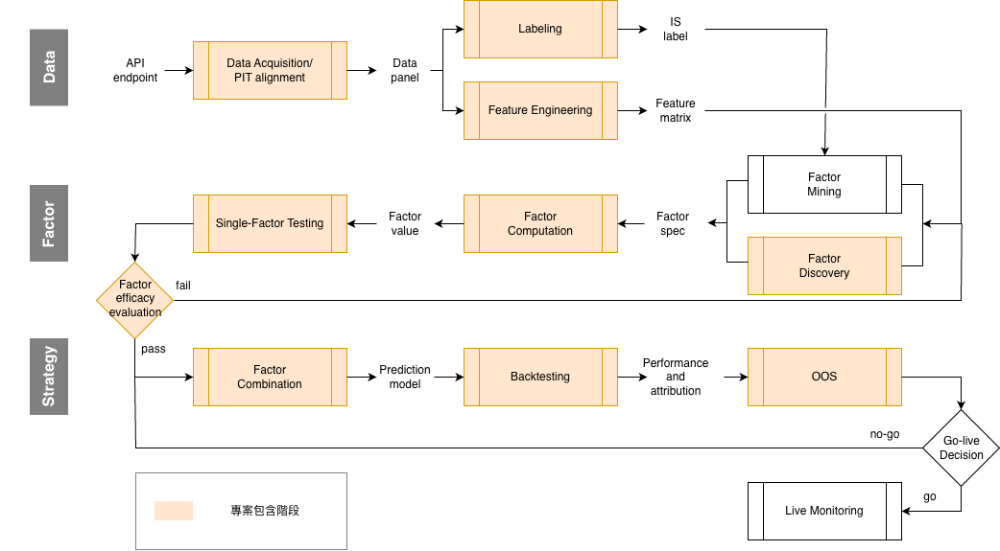

# Cross-Sectional-Crypto-Factor-Research-Lab

## 1. Project Overview

針對 10 種大市值加密貨幣現貨的三因子策略研究，涵蓋因子假設、單因子測試、因子合成與樣本外績效對比。

## 2. Process



- **Data Acquisition & Alignment**: 4H bars 轉換為 point-in-time 面板資料。
- **Single-Factor Testing**: Rank IC, IC IR, Tercile Spread, Rolling 6-month IC, 多變量覆蓋回歸 (multivariate spanning regression)
- **Factor Combination**
- **Backtesting**

## 3. Data & Setup

| | |
|---|---|
| Universe | BTC, ETH, SOL, BNB, XRP, ADA, DOGE, TRX, LINK, AVAX (Binance USDT spot) |
| Data | Binance 4h OHLCV only |
| Period | 2020-01 → 2026-08, 79 realized monthly returns |
| Rebalance | Monthly, 每個月第一個 4 小時 K 線的收盤時間 (04:00 UTC) |
| In-sample | 2020-01 → 2023-04 (n = 40) |
| Out-of-sample | 2023-06 → 2026-08 (39 months) |
| Costs | 26 bps round-trip = 2 x ( 3 bps fee + 10 bps slippage) |


```
💡 Cost Model

假設使用 BNB 支付 + referral (推薦人代碼) + VIP tier。成交 1 單位扣 13 bps。

```

## 4. Factors

| ID | Name | Horizon | Description |
|---|---|---|---|
| f001 | **MOM** | 1M forward | 上個月表現好的代幣，傾向下個月繼續保持領先 |
| f002 | **IVOL** (intraday vol regime) | 1M forward |  趨勢結構反映機構資金流持續性 |
| f003 | **AMIHUD** | 1M forward |  非流動性溢價 |


## 5. (WIP) Result & Future Work

- 所有因子 CI 信賴區間都包含 0，統計不顯著，無法證明有預測力。
- 僅使用兩個因子（MOM + AMIHUD）執行兩種策略回測: Rule-based, LightGBM，小幣池 × 只選前 5 種在結構上限制模型差異化。
- 策略無法贏過 BTC buy-and-hold。推論，比特幣在樣本期內主導整個市場。

### 未來改善
- 增加幣數 N，以提升單一因子橫截面統計顯著性。
- 增加期數 T，以提升因子平均 CI 統計顯著性。
- 尋找具有超額報酬解釋力之新因子。例如: 山寨幣移除 BTC 影響 (對 BTC 做回歸計算殘差)
- 增加因子數，進行模型合成與等權策略之績效比對。
