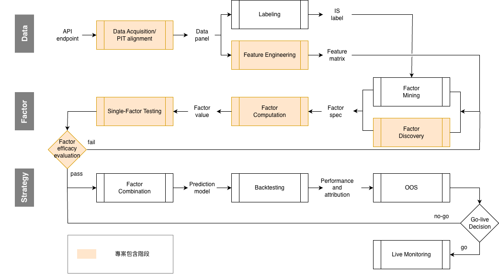
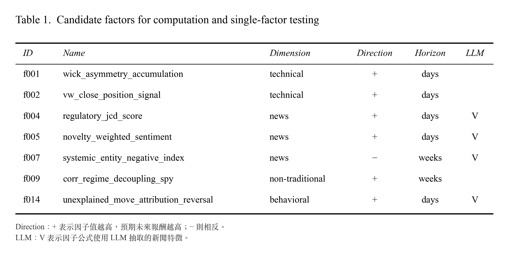

# LLM-Factor-Discovery-Lab

## 1. Project Overview

專案目標在建立一套 LLM-based 的因子研究機制:
- 生成: 由 LLM 發想潛在因子，並加入行為經濟學領域拓展維度。每個因子在探勘階段就寫上數值門檻的失敗條件，並在後續執行驗證。
- 抽取: LLM 產出傳統 classifier 做不到的結構化特徵抽取。例如: 法規維度拆解、實體影響加權、新穎度加權等。
- 驗證: 事前已算出樣本數的偵測門檻，每個因子需要多少觀測才能被證偽，成為可驗算的數字。礙於資料樣本數限制，本專案難以證明典型因子之有效性。後續並無有效因子結果是預測中的。
- 工程: prompt engineering 與 AWS Bedrock 的實測結論，多項與直覺相反 —— 較長的 prompt 反而便宜、同 pool 加 worker 反而更慢。

## 2. Pipeline



- **Data Acquisition & Alignment**: Binance OHLCV + CryptoNews corpus
- [**Factor Discovery**](<01_LLM Factor Discovery_v1.md>): LLM (Sonnet 4.6 + Fable 5.1)
- [**Feature Engineering**](<02_Feature Extraction and Engineering_v1.md>): LLM (Haiku 4.5) + MiniLM embeddings
- **Factor Computation**
- **Single-Factor Testing**


## 3. Data & Setup

| | |
|---|---|
| 標的 | BTC/USDT Spot, 單一標的 |
| 頻率 | 日線 |
| 期間 | 2026-03-12 → 2026-09-07, 180 天 |
| 價格 | OHLCV |
| 新聞 | CryptoNews API Premium,**27,272 篇**,經 LLM 抽取 16 欄特徵 |
| LLM | AWS Bedrock:Sonnet 4.6(探勘)、Haiku 4.5(抽取) |
| 成本 | 約 $75 |

```
💡 單一標的 × 180 天的統計後果

加密貨幣由 BTC 單一資產主導。但是單一資產下橫截面無定義，本專案只能算 time-series IC，每一個 horizon 只產出一個數字。
```


## 4. Candidate Factors

進行 Factor Computation、Single-Factor Testing 的七個因子，有 4 個依賴 LLM 抽取的新聞特徵 —— 這是專案的核心差異點。



## 5. Result & Future Work

本專案研究的 IC 信賴區間又寬又含 0，無法有效識別因子是屬於「完全無效」還是「典型好因子」。同時，單一資產導致 IC 為時序排名，而不是業界常看到的橫截面 (cross-sectional) 資產定義。未來改善:

- 增加單期橫截面樣本數: 幣數，提升 IC 統計顯著性。
- 增加樣本期數: rebalance 次數，提升策略統計顯著性。
- `sentiment` 的欄位設計同時包含了語氣 `positive` 以及 市場方向判斷 `bearish` 概念，一致性過高。未來考慮拆開欄位。 


