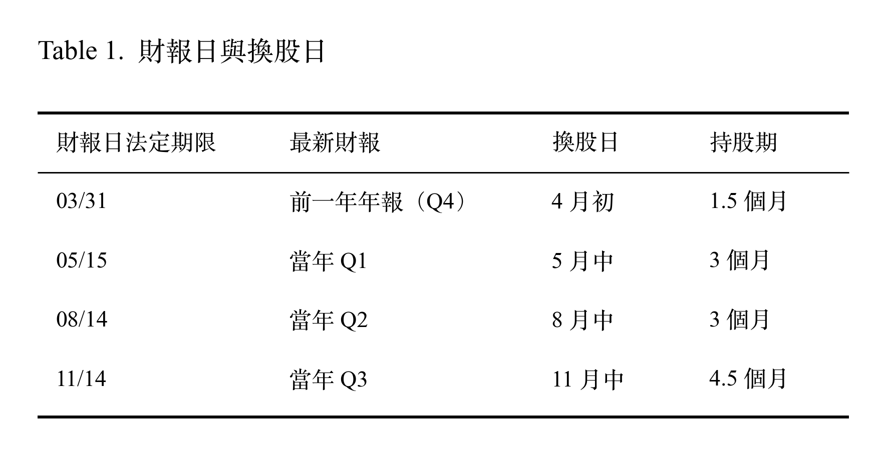

# Data Acquisition

## 1. Overview

本章節說明台股五因子研究的資料取得與樣本設計：從 TEJ TQuant Lab 下載 4 張原始資料表，依財報實際公告日對齊市場資訊與換股日，並將研究期間切分為暖機期、IS、OOS 三段。

### Conclusion

- 4 張表、67 個檔案，涵蓋 2005-01-03 至 2026-09-24。受每日 API 額度限制，分 3 天下載完成。
- 換股日固定為新制法定期限後的第一個交易日。財報則依實際公告日取用，每家公司只使用換股日前一個交易日已公告的財報，沒有前視偏誤。
- 研究第一期從 2009-05 開始：自 2008 年第一季起才有單季財報資料，而 A1 因子需要連續四季，因此 2009-05 是 10 個因子都能計算的第一期。
- 樣本規模：IS 34 期、OOS 35 期，季頻；2008 金融海嘯不在研究期內。

## 2. Data Acquisition

| 項目 | 說明 |
|---|---|
| Data Source | TEJ TQuant Lab（方案 `TQ_高手過招`） |
| Tool | `tejapi` 0.1.31 |
| Quota | 每日 1,000 次請求、3,000 萬筆 |
| Table | 4 張（交易日曆 `TWN/TRADEDAY_TWSE`、財報 `TWN/AINVFINB`、股票屬性 `TWN/APISTKATTR`、股價 `TWN/APIPRCD`） |
| Period | 2005-01-03（第一個交易日）到 2026-09-24（最後一個交易日）（`data_end_date`） |
| Stock Range | 上市、上櫃、已下市櫃的所有證券（包括 ETF、指數、與金融股等等） |
| File Size | 67 個 parquet，共 119.2 MB |
| API Usage | 2,332 requests，分 3 天完成（低於每日 quota 10% 時停止，隔天續傳） |

### Raw Data
| 資料表 | 檔案 | 筆數 | 請求數 | 大小 |
|---|---|---|---|---|
| 交易日曆 | 1 | 7,938 | 22 | 0.2 MB |
| 財報 | 22 | 670,115 | 77 | 8.4 MB |
| 股票屬性 | 22 | 9,844,255 | 1,117 | 3.1 MB |
| 股價 | 22 | 9,843,790 | 1,116 | 107.5 MB |
| **合計** | **67** | **20,366,098** | **2,332** | **119.2 MB** |

## 3. PIT Processing

下載的 Raw data 範圍：2005-01-03（第一個交易日）到 2026-09-24（最後一個交易日）。

### 財報日與換股日（Rebalance time）
2013 年台股切換法定財報公布日。本專案定義換股日（rebalance time）固定為新制法定期限（3/31、5/15、8/14、11/14）之後的第一個交易日；每家公司的財報依實際公告日取用，只使用換股日前一個交易日已公告的版本。2013 年以前的舊制下，這些日期部分公司的財報還沒公布，會使用到較舊的一期。因此，2013 年前的財報類因子（A0、A1、B0、B1）使用資訊較舊。

  

> 單因子檢定使用截面排名、LightGBM（LGBM）label 使用報酬排名：排名只比較同一期內的股票，持有期長短不影響。
> 但 LS 等報酬平均值則包含長短不一的持有期。

**Start time 調整**：以前只有半年報與年報，單季財報自 2008 年第一季起提供。受影響的因子 A1 需要連續四季財報資訊，可得的最早的四季是 2008-06 到 2009-03（對齊專案財報公布日），因此研究第一期從 **2009-05**、十個因子都能計算開始。

**End time 調整**：每期報酬 label 計算到下一個換股日；最後一期可得資料與報酬為 2026-08 資訊，因此可觀測最後一期換股日為 **2026-05**。

## 4. Data Slice

| Slice | 期間 | 期數 T | 專案使用 |  風險與事件 |
|---|---|---|---| --- |
| 暖機期 |  2006-04 到 2009-04 | 0–12（共 13 期） | 因子計算所需歷史資料窗口：250 日 β（D0）與波動度（D1）、前四季 ROE（A1）。不做任何檢定。 | 2005 到 2007 年只有半年報與年報、2008 金融海嘯（不在研究樣本內） |
| IS | 2009-05 到 2017-08 | 13–46（共 **34** 期） | 單因子檢定、選出勝者因子、LGBM 初始訓練資料 | 2013 財報公告日切換 |
| OOS | 2017-11 到 2026-05 | 47–81（共 **35** 期） | 策略回測試驗、績效統計 | 2020 疫情崩跌、2022 升息空頭、2023 AI 行情 |

