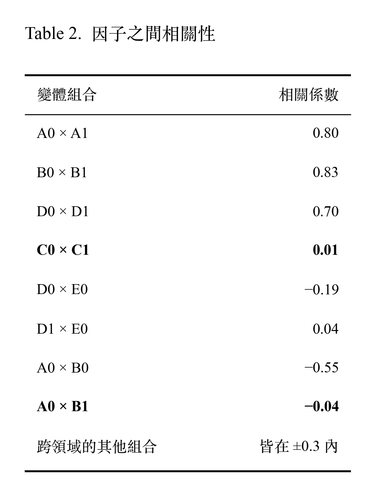
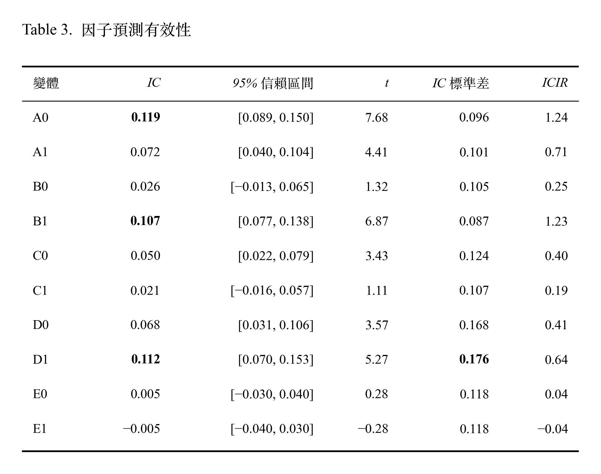
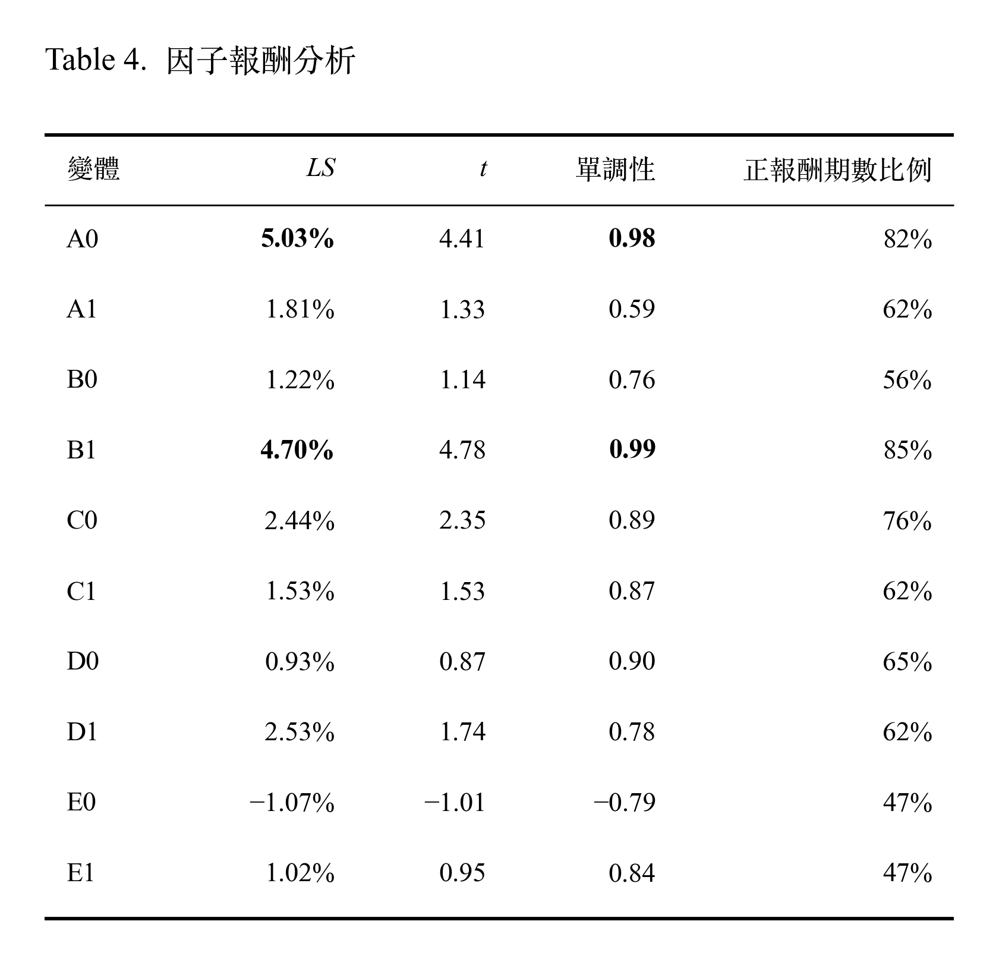

# 單因子檢定與選擇

## 1. Overview

本章節以 IS 34 期檢定 5 個因子領域、共 10 個變體的預測力與報酬，每個領域選擇 LS 大者為勝者因子，作為後續策略回測的 5 因子組合。

### (WIP) Conclusion

- **A0（單季 ROE）、B1（殘差 PB）最穩健**：IC、LS 指標皆顯著。
- **B1 的殘差設計有效**：B0 與 A0 高度負相關（−0.55），表示 PB 便宜股效果與單季 ROE 獲利較好互相拖累；B1 排除獲利的影響後，IC 從 0.026 提升到 0.107，LS 從 1.22% 提升到 4.70%。
- **勝者為 A0、B1、C0、D1、E1**

## 2. Research Design

### 2.1 IS Sample（2009-05 到 2017-08，8.5 年）

| 項目 | 設定 |
|---|---|
| 股票池 | 上市櫃普通股（排除金融業）、每期市值前 50%（每期約 575–850 檔） |
| 換股頻率（Rebalance time） | 季頻，財報法定期限（03/31、05/15、08/14、11/14）後的第一個交易日 |
| 檢定期間 | IS：2009-05-18 到 2017-08-15（共 34 期） |
| 資訊時點 | 只使用換股日前一個交易日（含）以前已公開的資訊 |
| 報酬 | 下一期含權息毛報酬（未扣交易成本）|

### 2.2 五個領域、十個變體

v0 參考葉怡成教授提出的台股因子概念與方向；v1 為本專案因子層面與策略層面的優化假設與實驗。

<p align="center">
  
</p>

## 3. Single Factor Evaluation Result

### 3.1 因子之間相關性

**先初步測量兩個因子之間「看好的股票是否相同」，完全不涉及報酬好壞**。
- 使用 10 × 10 的矩陣，檢驗變體每一期的排名相關。再取 IS 34 期的平均。
- 為了測量，先調整過所有因子方向為數值越大越好，因此相關係數為正代表兩個因子看好同一批股票；為負代表看法相反。

<p align="center">
  
</p>

#### 解讀
- 同領域的變體之間高度相關，提供的資訊大致重複。
- C0 × C1：C0 看 (T−21, T−1]，C1 看 (T−61, T−21]，兩個變體排名幾乎不相關（0.01）。
- D0 × E0：小 beta 排名高的股票，市值排名略低（−0.19）。推論：大市值權值股和大盤高度連動，beta 較高，所以 D0 會系統性地稍微避開它們。D1 沒有這個偏向（D1 × E0 0.04）。
- A0 × B0：−0.55 為強負相關，表示 ROE 高的公司，PB 通常也高，說明了「賺錢的公司通常不便宜」。推論：等權合成時，A0 想買賺錢的公司，B0 想買便宜的公司，而這兩群股票大多不同，兩個因子的訊號會互相抵銷。
- A0 × B1：A0 與 B1 幾乎無關（−0.04）。表示使用殘差計算，殘差 B1 已去除 PB 中可由迴歸變數 A0 解釋的部分，可以確實把以獲利解釋的部分拿掉。
- 其餘不同領域的兩兩變體相關都在 ±0.3 以內，變體提供的資訊比較獨立。

---

### 3.2 因子預測有效性

**因子值的排名，能不能預測下一期報酬的排名？**

<p align="center">
  
</p>

#### 解讀
- A0、B1、D1 的預測能力強。同時 D1 標準差（0.176）是所有變體當中最高的，表示 D1 預測能力很強但是波動也最大。
- B1 IC （0.107, t 6.87）預測力遠大於 B0 IC（0.026, 1.32），表示殘差設計排除獲利因素是可以提升預測能力的。
- E0 和 E1 的 IC 完全對稱且不顯著（IC ±0.005, t ±0.28）。表示規模因子在 IS 沒有預測能力。
- 用 |t| > 3 作為較嚴格的門檻，A0、A1、B1、C0、D0、D1 共 6 個變體仍然顯著。其中 A0、B1 的 t 遠高於門檻，結果最明確。

```
💡 IC 顯著的因子，不代表有顯著的報酬。需再進行因子報酬分析。
```

---

### 3.3 因子報酬分析

本節比較因子是否帶來報酬，以及這個報酬能否被其他因子組合出來。每期將股票池依因子值分為 10 組：
- **十分位平均 LS**：為第 10 組（最佳）減第 1 組的等權報酬，衡量因子兩端的報酬差距。
- **單調性**：10 組平均報酬與組別的 Spearman 相關；接近 1 代表報酬隨組別穩定遞增，效果不只集中在兩端。

<p align="center">
  
</p>

> LS 為 34 期平均報酬；正報酬期數比例代表 LS 大於 0 的期數比例。

#### 解讀
- **A0、B1 是最穩健的因子**：LS 最高、單調性接近 1、超過 80% 的期數為正、α 顯著。報酬大部分是獨有的。
- A1 在第 7 組報酬最高，第 10 組反而下降（單調性 0.59）。這代表 A1（近四季 ROE） 因子值高的股票表現不如中段，只買排名最前面的股票不一定最好。
- B0 的 α（2.37%）大於 LS（1.22%），再次說明了便宜的股票通常獲利較差（對獲利 A0 的 β 為 −0.35）。B1 直接排除獲利的影響，價值效果變強 LS 提高到 4.70%。
- C0 平均 LS 為 2.44%、76% 的期數為正，但 α 接近 0（對 A0 的 β 為 0.40），報酬大部分可由獲利因子解釋，沒有增量資訊。
- C1、D0、D1 的 α 為正但不顯著：例如 D1 的 LS 達 2.53%，但 t(α) 只有 0.89，報酬波動大，34 期的樣本難以和雜訊區分。
- 規模因子無效：E0、E1 的 LS 與 α 都不顯著，正報酬期數比例皆為 47%，不到丟硬幣的一半。

## 4. Winner Factors

**選擇規則**：每個領域中，LS 較高的變體勝出

| 領域 | v0 / v1 的 LS | 勝者 |
|---|---|---|
| 獲利 | 5.03% / 1.81% | **A0** |
| 價值 | 1.22% / 4.70% | **B1** |
| 動能 | 2.44% / 1.53% | **C0** |
| 風險 | 0.93% / 2.53% | **D1** |
| 規模 | −1.07% / 1.02% | **E1** |

### 穩健性：換一個指標，勝者會改變嗎？

| 領域 | LS（第 10 組 − 第 1 組） | 多方超額報酬（第 10 組 − 股票池平均） | IC |
|---|---|---|---|
| 獲利 | A0 | A0 | A0 |
| 價值 | B1 | B1 | B1 |
| 動能 | C0 | C0 | C0 |
| 風險 | D1 | D1 | D1 |
| 規模 | E1 | E1 | E0 |
> 本研究的策略只做多，賺不到空方的報酬。

- A–D 四個領域在三種指標下的勝者完全一致。規模領域 E 雖然在 IC 下 E0 勝出，但它其實在樣本內的任何統計指標都不顯著，不影響結果判斷。
- D1 方向正確。但是 LS 2.53% 組成為做多 0.74% 與做空 1.78%，代表 D1 主要的資訊是「找出會跌的高波動股」，而不是「找出會漲的股票」。
- 本研究的策略是把 5 個因子的排名合成，再選出前 2% 的股票。D1 在其中的作用是：辨識高波動股票，把高波動股的綜合分數往下拉，預期可有效降低策略風險。
