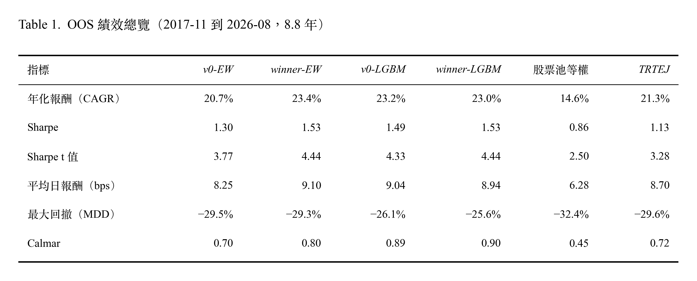
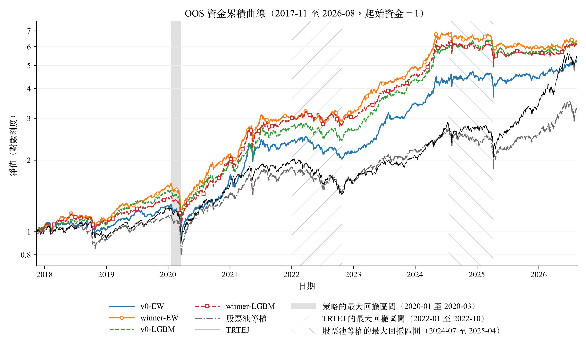
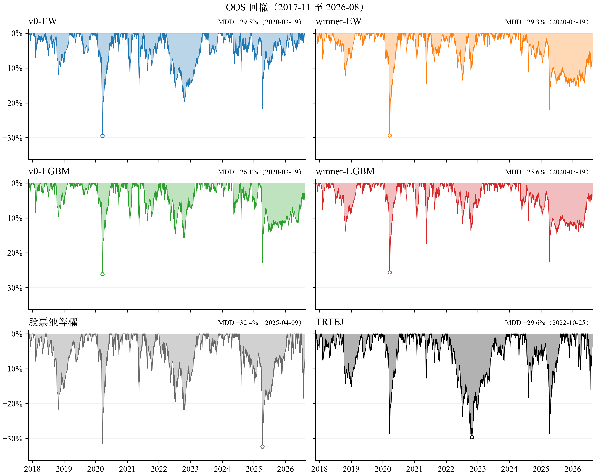
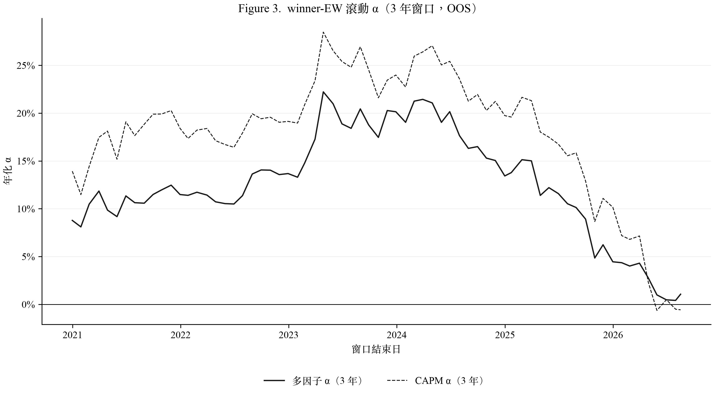
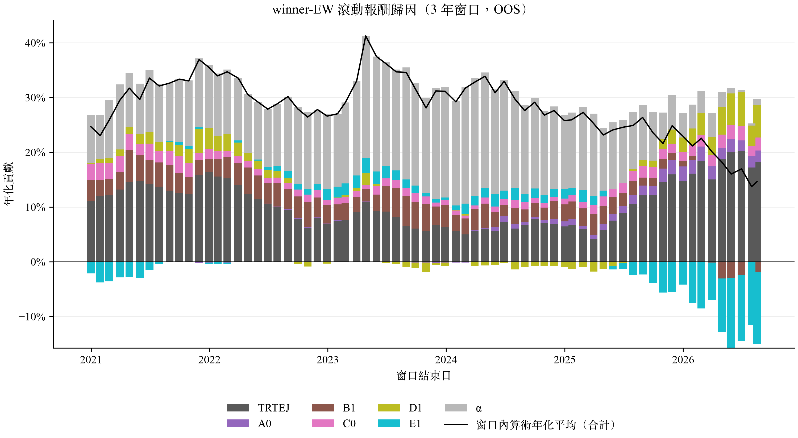
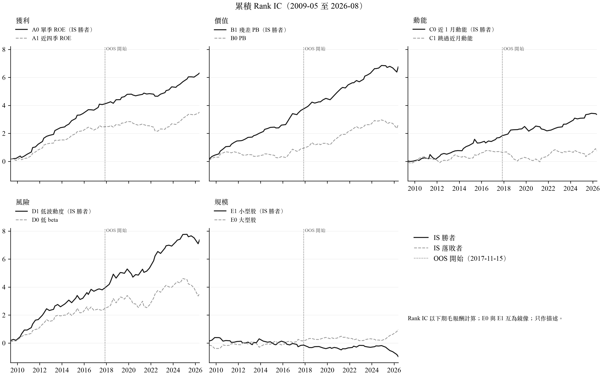

# Backtesting 回測結果報告

## 1. Overview

4 個策略（v0-EW、winner-EW、v0-LGBM、winner-LGBM）和兩個參照基準（股票池等權、大盤），以 IS、OOS 做策略績效回測以及解讀。

### (WIP) Conclusion

- 因子變體的選擇與合成方式，樣本外回測結果不顯著。
- 因子選擇沒有過擬合跡象，有 4 個領域 IS 勝者因子 OOS 仍然顯著勝出；策略層因為檢定力不足，無法判斷。
- **策略的絕對表現強，但 OOS 期間相對大盤只是大致持平**。等權股票池落後大盤導致選股優勢不顯著。推論，OOS 期間大盤受少數大型權值股推升。
- 只做多的策略仍會隨市場系統性風險而下跌。4 個策略的最大回撤都發生在 2020 年 3 月的疫情急跌。
- 單因子檢定的勝負大致延續（規模因子例外，OOS 轉為大市值 E0 較佳），但沒有轉化為策略層級的優勢。

## 2. Backtesting Design

### 2.1 Backtesting Setting

| 項目 | 設定 |
|---|---|
| 因子 | 5 個領域（獲利、價值、動能、風險、規模） |
| v0／winner | v0：每個領域原始的因子；winner：依 IS 單因子分析選出的因子變體 |
| 合成策略 | EW：等權合成；LGBM：LightGBM 預測模型 |
| 樣本內（IS） | 2009-05 到 2017-08（34 期） |
| 樣本外（OOS） | 2017-11 到 2026-08（35 期） |
| 操作方式 | 做多操作 |
| 買入操作 | 買進排名前 2%，持股等權 |
| 賣出操作 | 賣出跌出前 10% |
| 換股頻率（Rebalance time） | 季頻，財報法定期限（03/31、05/15、08/14、11/14）後的第一個交易日 |
| 成本 | 手續費 0.1425%（雙邊）、證交稅 0.3%（賣出）、滑價 0.1%（雙邊） |
| 基準 | TRTEJ（含息報酬指數）、股票池等權組合作為參照 |
> OOS 到 2026-05 為最後換股日；2026-08 為最後一期持有結束日，記錄最後一期報酬

### 2.2 策略說明

| 策略 | 因子 | 合成 | IS 實驗 | OOS 實驗 |
|---|---|---|---|---|
| v0-EW | A0、B0、C0、D0、E0 | 1/5 等權相加 | 回測 | 回測 |
| winner-EW | A0、B1、C0、D1、E1 | 1/5 等權相加 | 回測 | 回測 |
| v0-LGBM | A0、B0、C0、D0、E0 | LGBM | （訓練、不回測） | （每年 walk-forward 訓練）、回測 |
| winner-LGBM | A0、B1、C0、D1、E1 | LGBM | （訓練、不回測） | （每年 walk-forward 訓練）、回測 |


## 3. 績效數字，Backtesting Result

### 3.1 OOS 績效總覽（2017-11 到 2026-08，8.8 年）

<p align="center">
  
</p>

> 股票池等權策略：換股時等權持有股票池中的全部股票（市值前 50% 股票，每期約 575–850 檔），成交與成本規則和策略相同；用來衡量「選股」本身的貢獻。
> TRTEJ：TEJ 編製的台股大盤報酬指數（含息），作為比較基準。

#### 解讀
- 4 個策略都優於股票池等權，年化報酬高出約 6–9 個百分點，表示選股優勢存在。
- 4 個策略與大盤大致持平。年化報酬 20.7%–23.4% 對 TRTEJ 的 21.3%；Sharpe 較高主要來自於年化波動較低，進一步分析請看 [3.4 IS vs OOS 每期超額報酬拆解](#34-is-vs-oos-每期超額報酬拆解) 。
- 4 個策略之間的差異小。Sharpe 都落在彼此的信賴區間內，勝者因子與 LGBM 優勢不顯著。
- LGBM 的回撤相較於 EW 策略較淺（約 −26% 對 −29%），也因此 Calmar 較高。但兩者的報酬差異不顯著。

---

### 3.2 資金累積曲線（對數）與最大回撤
<p align="center">
  
</p>

#### 解讀
- 2018 到 2024 年中，策略主要領先，資金累積速度持續高於股票池等權與 TRTEJ。
- 2024 年中以後，TRTEJ 則大幅上升，而策略大致持平。TRTEJ 在 OOS 最後一年追上 v0-EW 策略。這與超額報酬拆解的結論一致：OOS 中，策略相對大盤的優勢縮小，主要來自大盤變強（TRTEJ 黑色細線大幅上升）。

<p align="center">
  
</p>

#### 解讀
- 策略的最大回撤都發生在 2020 年 3 月的疫情急跌，深度 25.6%–29.5%。說明只做多的策略無法避開市場的系統性風險。
- 股票池等權與大盤的最大回撤發生在其他時期：股票池等權的最大回撤在 2025 年的急跌；TRTEJ 的最大回撤在 2022 年的空頭。
  - 推論：2022 年的大型科技股下跌較深。股票池等權以等權持有約 700 檔股票，大型科技股的比重遠低於大盤，降低了單一個股的影響；策略依獲利、價值、低波動等因子選股，這類股票在升息造成的空頭中通常較抗跌。
  - 推論：2024 年中以後同樣的，因為這兩者大型科技股的比重較低，在 2024 年中以後由大型科技股推升的台股多頭中，策略與股票池都跟不上大盤的漲勢。
- 策略自 2024 年中的高點以後，到 OOS 結束時仍未創新高（除了 v0-EW）。而 TRTEJ 在同一時期回到高點、屢創新高。這是策略近期表現落後大盤的另一個角度。

```
💡 市場事件

- 2018-10：美國升息與美中貿易戰，引發全球股市下跌。各序列回撤約 10%–20%。
- 2020-01 到 2020-03：新冠疫情引發全球股災。四個策略的最大回撤 25.6%–29.5%。
- 2022-01 到 2022-10：美國聯準會快速升息、俄烏戰爭。台股全年空頭，TRTEJ 的最大回撤 29.6%。
- 2025-04：美國宣布對等關稅之後。股票池等權在這段期間的最大回撤是 32.4%。
```

--- 

### 3.3 OOS 年化波動
| 序列 | 平均日報酬 | × 252 | Sharpe | 年化波動（約） |
|---|---|---|---|---|
| v0-EW | 8.25 bps | 20.8% | 1.30 | 16.0% |
| winner-EW | 9.10 bps | 22.9% | 1.53 | 15.0% |
| v0-LGBM | 9.04 bps | 22.8% | 1.49 | 15.3% |
| winner-LGBM | 8.94 bps | 22.5% | 1.53 | 14.7% |
| 股票池等權 | 6.28 bps | 15.8% | 0.86 | 18.4% |
| TRTEJ | 8.70 bps | 21.9% | 1.13 | 19.4% |
> 年化 Sharpe = 年化平均報酬 ÷ 年化波動（σ）

#### 解讀
- 策略的波動比大盤低約 3–5 個百分點，這是策略 Sharpe 高於大盤的主要原因。因為兩者的年化報酬其實相近。

## 4. 歸因

### 4.1 CAPM 分析
| 期間 | 序列 | β [95% CI] | α 年化（t） |
|---|---|---|---|
| IS | v0-EW | 0.71 [0.68, 0.74] | 15.2%（5.30） |
| IS | winner-EW | 0.67 [0.62, 0.72] | 15.0%（4.40） |
| IS | 股票池等權 | 0.93 [0.89, 0.97] | 0.1%（0.03） |
| OOS | v0-EW | 0.55 [0.49, 0.62] | 8.7%（1.96） |
| OOS | winner-EW | 0.50 [0.44, 0.57] | 11.9%（2.78） |
| OOS | v0-LGBM | 0.50 [0.43, 0.58] | 11.7%（2.65） |
| OOS | winner-LGBM | 0.51 [0.44, 0.57] | 11.5%（2.81） |
| OOS | 股票池等權 | 0.78 [0.74, 0.83] | −1.4%（−0.38） |

> 日淨報酬對 TRTEJ 日報酬迴歸；無風險利率為 0；年化 α = 日 α × 252。
> 範例：winner-EW 的 α = (9.1 bps × 252) − 0.5 × (8.7 bps × 252) ≈ 11.9%

#### 解讀

- 原始報酬持平，風險調整過後為正。OOS 當中 winner-EW 策略優勢（每期策略 − 每期大盤）+0.46% 不顯著；但是 CAPM α 年化 11.9%（t 2.78）
  - 風險調整：原先直接用（策略 − 大盤）等於假設 β = 1，假設策略承擔的市場風險跟大盤一樣多。
  - 但實際回歸後 β = 0.5，在 OOS 強勢多頭中，承擔一半的風險卻取得相近的報酬。
- α 從 IS 到 OOS 變小。可以看到 EW 策略的 α 從原本的約 15% 降到 8.7%–11.9%。從另外一個角度說明了選股優勢降低。
- β 從 IS 到 OOS 變小。可以看到 EW 策略的 β 從原本的約 0.67–0.71 降到 0.50–0.55，股票池等權也從 0.93 降到 0.78，代表整體與大盤的連動變弱。
- IS 和 OOS，股票池等權沒有 α，兩段期間 α 都接近 0，股票池本身只是低一點 β 的大盤。策略的 α 來自因子選股。

###  4.2 股票池落後大盤的拆解

**OOS 中股票池等權落後 TRTEJ，是等權持有的問題？還是股票池範圍的問題？**
- 股票池等權 − TRTEJ =（股票池等權 − 市值加權股票池）+（市值加權股票池 − TRTEJ）

| 拆解 | IS 每期平均差（t 值） | OOS 每期平均差（t 值） |
|---|---|---|
| 加權方式：股票池等權 − 市值加權股票池 | −0.16%（−0.29） | **−1.88%**（−1.71） |
| 範圍：市值加權股票池 − TRTEJ | +0.06%（0.42）  | +0.38%（1.85） |
| 合計：股票池等權 − TRTEJ | −0.09%（−0.15）  | −1.50%（−1.56） |

#### 解讀
- OOS 的落後，統計值顯示主要來自加權方式（−1.88%）
- OOS 中，市值加權跟 TRTEJ 的走勢很近（+0.38%，t 1.85），說明股票範圍（只選市值前 50%、排除金融股）的篩選條件，對於落後大盤的影響很小
- IS 中三段的差異都接近 0，等權與市值的加權方式差異主要出現在 OOS。
  - 結合 E1 小型股拖累報酬解讀，說明 OOS 期間，大盤受到大型權值股推升，而策略本身只有等權持有股票。

---

### 4.3 winner-EW 多因子回歸

**winner-EW 的日報酬，如果由各個風格解釋，各個風格各占多少比例的貢獻？扣掉市場曝險報酬以及風格曝險報酬還有多少 α？**
- 日淨報酬 r = α + β_市場 × R_TRTEJ日報酬 + β_因子 × R_因子日報酬

| 解釋變數 | OOS β | OOS 年化貢獻 | IS β | IS 年化貢獻 |
|---|---|---|---|---|
| TRTEJ（市場） | 0.54 | 11.9% | 0.74 | 7.9% |
| A0 單季 ROE | 0.02 | 0.3% | 0.08 | 1.6% |
| B1 殘差 PB | 0.31 | 1.9% | 0.24 | 4.3% |
| C0 近 1 月動能 | 0.15 | 2.3% | 0.13 | 1.3% |
| D1 低波動度 | −0.20 | 1.8% | −0.09 | −0.8% |
| E1 小型股 | 0.54 | **−4.6%** | 0.56 | 1.8% |
| **α（多因子）** | — | **9.4%** | — | 6.0% |
| 合計（算術年化平均） || 22.9% || 22.2% |

> 年化貢獻 = β × 因子日平均 × 252

| 項目 | OOS | IS |
|---|---|---|
| CAPM α 年化（t） | 11.9%（2.78） | 15.0%（4.40） |
| 多因子 α 年化（t） | 9.4%（3.06） | 6.0%（2.48） |
| 風格解釋比例 = 1 − 多因子 α ÷ CAPM α | 20.5% | 59.8% |


#### 解讀
- D1 因子 = 做多低波動、做空高波動。OOS 中控制其他因子後，β = −0.20 表示策略傾向和因子相反。但這只是事後曝險分析，真正移除 D1 是否會增加報酬，要看因子邊際貢獻分析。
- 扣除市場與 5 個風格後，winner-EW 在 OOS 仍有正的 α：年化 9.4%（t 3.06）。
- OOS 與 IS 相比，扣掉風格後的多因子 α 沒有下降（6.0% → 9.4%）。線性歸因無法解釋的報酬沒有消失。
- CAPM α 下降（15.0% → 11.9%），主要是因為風格合計貢獻大幅減少。
  - 其中，最主要來自 E1 報酬貢獻 +1.8% 變成 −4.6%。
  - 原因是小型股行情落後，不是曝險改變：E1 的 β 幾乎不變（0.56 → 0.54）
- 策略對於市場的敏感度變低，但是市場曝險報酬反而上升了（7.9% → 11.9%），說明 OOS 是強勢多頭、大盤平均報酬上升，但是策略只參與了約一半的漲幅。


## 5. 時變性

### 5.1 winner-EW 三年窗口滾動多因子回歸

**以三年窗口觀察 OOS 中 winner-EW 報酬風險回歸**

<p align="center">
  
</p>

#### 解讀
- 2021–2024 上半年：大部分期間，策略的 α 和風格曝險都很穩定。α 最強的期間（約 18%–22%）發生在 2023 年。
- 2024 下半年後：無論是 CAPM α 還是多因子 α 都持續下降，到 2026-08 已接近於 0。
  - 2025 年後，E1 小型股從小幅貢獻轉為大幅拖累。市場貢獻則變成報酬的主要來源。
- α 曾經長期存在，但是最近三年的 α 接近消失。


<p align="center">
  
</p>

#### 解讀
- 2021–2025：報酬主要來自 α（15%–25%），市場貢獻較少（2021–2022：11%–16%，2023–2025：5%–9%）。E1 小型股貢獻很少。
- 2025 下半年：策略報酬改為市場報酬為主（15%–20%），α 縮小到接近 0。E1 小型股貢獻大幅為負。全期多因子回歸全期貢獻 −4.6%，主要集中在這段期間。
- 風格曝險一直都沒有劇烈變動，近期的報酬與 α 轉弱，主要受到 E1 的負報酬拖累，所以風格行情不利主要來自於小型股行情不利。
- 報酬來源輪動：α、市場、風格輪流主導解釋。

### 5.2 累積 Rank IC
<p align="center">
  
</p>

> Rank IC 以下期毛報酬計算（不含交易成本）；E0 與 E1 互為鏡像

#### 解讀
- 多數因子在 OOS 仍有正的預測能力。獲利（A0）、價值（B1）、動能（C0）、風險（D1）等勝者因子，累積 IC 在 OOS 持續上升，但是斜率比 IS 平緩。預測能力減弱，與平均 IC 解讀一致。
- B0 的斜率在 OOS 變陡，PB 出現微弱預測力。
- C1 在兩個期間都幾乎持平，幾乎沒有預測力。
- E0、E1 規模因子在 IS 沒有方向，OOS 轉為大型股較佳。
- **2025 到 2026 年多個因子同時轉弱**（由圖觀察）：殘差 PB（B1）、低 beta（D0）、低波動度（D1）的累積 IC 轉為下降，規模往大型股方向加速。推論，未經驗證：這段期間由大型高市值股主導，與價值、低風險、小型股方向相反。這與策略在 2024 年中以後資金累積持平、股票池落後大盤的解讀一致。準確時間點引用 5.1。

