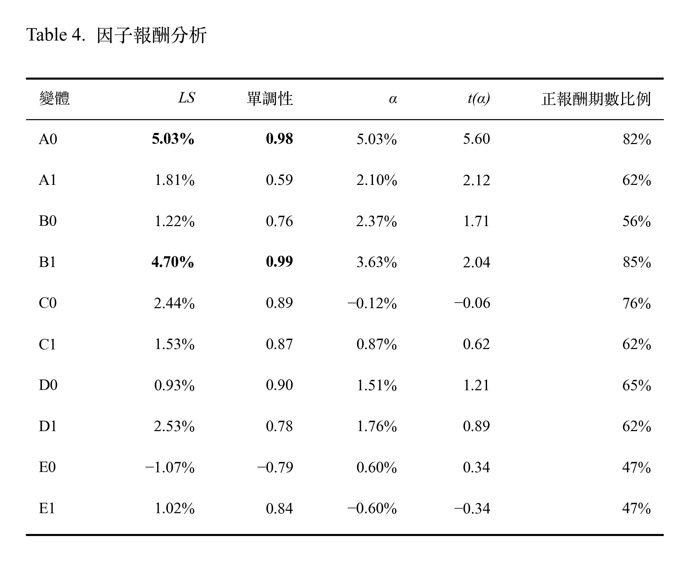

# 因子補充分析

## 1. IS 因子 Spanning 迴歸

- **Spanning 迴歸**：將因子的 LS，對其他 4 個領域 v0 變體的 LS + 市場報酬（股票池等權平均報酬）做時間序列迴歸（共 34 期），截距 α 是扣除對其他因子與市場的曝險後，剩下的平均每期報酬，代表無法被其他因子解釋的報酬。
  - α 顯著大於 0（t 值），表示該變體提供了其他因子沒有的資訊。
  - α < LS，表示這個單一因子的部分報酬，可被其他因子的報酬解釋；部分報酬來自和其他因子或市場一起漲跌。
  - α > LS，表示來自其他因子的貢獻加總為負，原始報酬被拖累了；曝險拖累了平均報酬。

<p align="center">
  
</p>

- A0、B1 是最穩健的因子：LS 最高、單調性接近 1、超過 80% 的期數為正、α 顯著。報酬大部分是獨有的。
- B0 的 α（2.37%）大於 LS（1.22%），再次說明了便宜的股票通常獲利較差（對獲利 A0 的 β 為 −0.35）。B1 直接排除獲利的影響，價值效果變強 LS 提高到 4.70%。
- C0 平均 LS 為 2.44%、76% 的期數為正，但 α 接近 0（對 A0 的 β 為 0.40），報酬大部分可由獲利因子解釋，沒有增量資訊。
- C1、D0、D1 的 α 為正但不顯著：例如 D1 的 LS 達 2.53%，但 t(α) 只有 0.89，報酬波動大，34 期的樣本難以和雜訊區分。
- 規模因子無效：E0、E1 的 LS 與 α 都不顯著，正報酬期數比例皆為 47%，不到丟硬幣的一半。

```
💡 金融原理假設

D0 傾向不選和大盤高度連動的大型權值股。也就是佔指數權重很大的科技電子類股（尤其是半導體）會有高 beta，D0 會系統性的避開，與 D1 會有部分的產業曝險差異。
```

## 2. 勝者穩健性：換一個指標，勝者會改變嗎？

| 領域 | LS（第 10 組 − 第 1 組） | 多方超額報酬（第 10 組 − 股票池平均） | IC |
|---|---|---|---|
| 獲利 | A0 | A0 | A0 |
| 價值 | B1 | B1 | B1 |
| 動能 | C0 | C0 | C0 |
| 風險 | D1 | D1 | D1 |
| 規模 | E1 | E1 | E0 |
> 本研究的策略只做多，賺不到空方的報酬。

- A–D 四個領域在三種指標下的勝者完全一致。規模領域 E 雖然在 IC 下 E0 勝出，但它其實在樣本內的任何統計指標都不顯著，不影響結果判斷。
- D1 方向正確。但是 LS 2.53% 組成為做多 0.74% 與做空 1.78%，代表 D1 主要的資訊是「找出會跌的高波動股」，而不是「找出會漲的股票」。
- 本研究的策略是把 5 個因子的排名合成，再選出前 2% 的股票。D1 在其中的作用是：辨識高波動股票，把高波動股的綜合分數往下拉，預期可有效降低策略風險。
