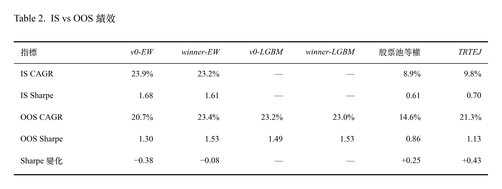
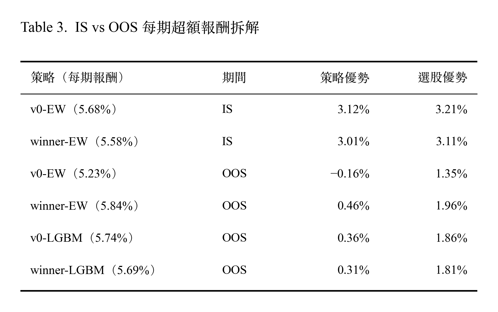
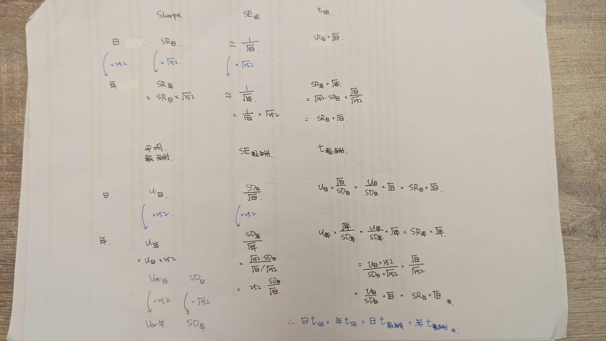

# 策略補充分析

## 6. 研究問題

### 6.1 研究問題
```
💡 研究問題

研究問題一：winner vs. v0，依 IS 單因子表現挑選出的變體勝者，OOS 上能否也改善策略？
研究問題二：LGBM vs. EW，用機器學習合成因子，能否勝過簡單的等權合成？
```

| 問題 | 比較 | 平均每期報酬差 | 每期 95% 信賴區間 | 結論 |
|---|---|---|---|---|
| 問題一 | (winner-EW) − (v0-EW) | +0.61%（年化約 +2.4%） | [−1.17%, 2.40%] | 包含 0，不顯著 |
| 問題一 | (winner-LGBM) − (v0-LGBM) | −0.05%（年化約 −0.2%） | [−1.36%, 1.27%] | 包含 0，不顯著 |
| 問題二 | (v0-LGBM) − (v0-EW) | +0.51%（年化約 +2.0%） | [−1.03%, 2.05%] | 包含 0，不顯著 |
| 問題二 | (winner-LGBM) − (winner-EW) | −0.15%（年化約 −0.6%） | [−1.20%, 0.90%] | 包含 0，不顯著 |

#### 解讀
- 因子差異不顯著。以問題一為例，資料仍容許 winner-EW 每期報酬少約 1.17% 到領先約 2.4%。
- LGBM 與等權差異小。推論在少因子數合成上，LGBM 常退化為接近等權的排序。既然沒有偵測到差異，較簡單的等權合成在 5 因子策略的開發、維護成本上較有優勢。

---

### 6.2 真實值與所需樣本估算

<p align="center">
  
</p>

> 要在 5% 顯著水準下有八成的檢定力，真實的 δ 要大約 2.8 倍標準誤

---

### 6.3 OOS 單因子檢定

**相同規則**：OOS 每個領域中，LS 較高的變體勝出。比較因子勝者是否延續到樣本外。

| 領域 | v0 / v1 IC | v0 / v1 LS | OOS LS 勝者 |
|---|---|---|---|
| 獲利 | 0.065 / 0.031 | 2.97% / 0.07% | **A0** |
| 價值 | 0.050 / 0.089 | −0.54% / 1.37% | **B1** |
| 動能 | 0.047 / 0.001 | 3.86% / 2.23% | **C0** |
| 風險 | 0.035 / 0.102 | −4.71% / −2.17% | **D1** |
| 規模 | 0.023 / −0.023 | 2.12% / −2.12% | **E0** |

> IS 勝者：A0、B1、C0、D1、E1

#### 解讀
- 5 個領域中有 4 個的 IS 勝者在 OOS 仍是勝者，只有規模反轉（大型股較佳）。勝負差的信賴區間不包含 0 的只有獲利、價值、風險。規模在 IS 本來就沒有預測力，OOS 的反轉也不顯著。
- D1 依然勝過 D0，顯示低波動度的預測能力在樣本外依然勝過低 beta。兩者 LS 都為負。推論，未經驗證：LS 做多低風險股、做空高風險股，OOS 中帶有負的市場曝險，OOS 為強勢多頭（股票池等權年化 14.6%），而高風險股漲得較多，因此 LS 被拖累。
- 單因子層級的勝負大致延續，但沒有轉化為策略層級的優勢（同問題一）：OOS 中 winner-EW 每期比 v0-EW +0.61%（因子勝者 OOS 上策略績效不顯著勝利）。

```
💡 加入風險因子會降低策略報酬嗎？

專案實驗無法證明「有風險因子」與「沒有風險因子」的報酬差異。需要另外回測檢驗。
```

## 7. IS vs OOS 擬合

### 7.1 IS vs OOS 績效

<p align="center">
  
</p>

> IS：2009-05 到 2017-08（34 期）、OOS：2017-11 到 2026-08（35 期）；
> Sharpe 變化 = OOS Sharpe − IS Sharpe；
> LGBM 沒有 IS 回測，以「—」表示

#### 解讀
- v0-EW 策略的 Sharpe 從 IS 到 OOS 降了 0.38。winner-EW 的 Sharpe 只降了 0.08，年化報酬幾乎不變。推論，勝者因子依然有解釋報酬的能力，進一步分析請看 [3.5 OOS 單因子檢定](#35-oos-單因子檢定) 與 [3.6 累積 Rank IC](#36-累積-rank-ic)。
- 大盤的 Sharpe 上升。推論：策略相對大盤的優勢，主要是因為大盤變強而縮小，不是策略本身大幅變差。
- winner-EW 在樣本內年化報酬本來沒有勝過 v0-EW（−0.70%），在樣本外反而領先約 2.70%。但是策略層檢定力無法判斷是否過擬合 (以 OOS 35 期來說，5% 顯著水準下要有 80% 機會測試出來，每一期差距至少要 2.5%) ，過擬合證據可參考單因子層級勝者延續 [3.5 OOS 單因子檢定](#35-oos-單因子檢定) 。

---

### 7.2 IS vs OOS 每期超額報酬拆解

拆解方式：
- **`策略優勢`**（每期超額報酬）= 策略 − 大盤
- **`選股優勢`** = 策略 − 股票池等權
- `策略優勢` = `選股優勢` +（股票池等權 − 大盤）
- IS（34 期）每期報酬：股票池等權 = 2.47%；大盤 = 2.56%；股票池等權 − 大盤 = −0.09%
- OOS（35 期）每期報酬：股票池等權 = 3.88%；大盤 = 5.38%；股票池等權 − 大盤 = −1.50%

<p align="center">
  
</p>

> 大盤指的是指數報酬（TRTEJ）；上表皆為每期平均報酬（每期約一季）

#### 解讀
- 策略本身的報酬在 OOS 沒有明顯下降。兩個 EW 策略每期報酬從 IS 的 5.68%、5.58%，變為 OOS 的 5.23%、5.84%。
- 選股優勢從每期約 3% 縮小到 1.35%–1.96%，後續統計說明 OOS 多數因子的 IC 仍為正但轉弱。進一步分析請看 [3.5 OOS 單因子檢定](#35-oos-單因子檢定) 與 [3.6 累積 Rank IC](#36-累積-rank-ic)。縮小主要來自 E1 風格報酬，參見 4.3。
- OOS 大盤強勢。大盤的每期報酬在 OOS 約增加為兩倍（TRTEJ 從 2.56% 升到 5.38%）。而股票池等權只從 2.47% 升到 3.88%，OOS 每期落後大盤 1.50%。
- 策略優勢的縮小，約一半來自選股優勢減弱、約一半來自股票池落後大盤。以 IS 到 OOS 的每期變化計算：
  - v0-EW 的策略優勢減少 3.28 百分點 = 選股優勢減少 1.86（約 57%）+ 股票池相對大盤減少 1.41（約 43%）
  - winner-EW 的策略優勢減少 2.55 百分點 = 選股優勢減少 1.15（約 45%）+ 股票池相對大盤減少 1.41（約 55%）
- 推論，未經驗證：OOS 期間大盤受少數超大型權值股推升，等權的股票池跟不上；這與後續觀察規模因子反轉（大型股較佳）的方向一致。


## 8. 筆記

### 8.1 日、年 Sharpe Ratio（SR）以及 SE(SR)

<p align="center">
  
</p>

<p align="center">
  
</p>

> 日 SR 的 t ≈ 年 SR 的 t ≈ 日報酬的 t = 年報酬的 t

---

## 9. 因子邊際貢獻


