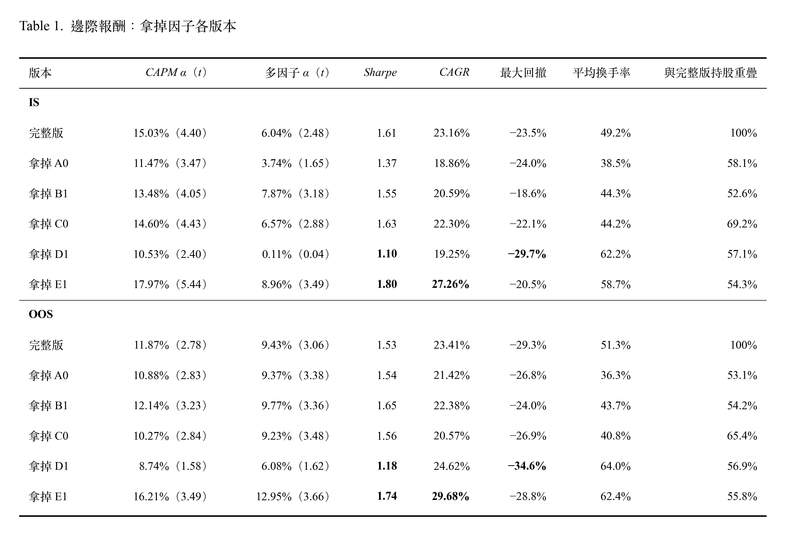

# 策略調整

---
## Overview

## 累積 Rank IC

  

> Rank IC 以下期毛報酬計算（不含交易成本）；E0 與 E1 互為鏡像

#### 解讀
- 多數因子在 OOS 仍有正的預測能力。獲利（A0）、價值（B1）、動能（C0）、風險（D1）等勝者因子，累積 IC 在 OOS 持續上升，但是斜率比 IS 平緩。預測能力減弱，與平均 IC 解讀一致。
- B0 的斜率在 OOS 變陡，PB 出現微弱預測力。
- C1 在兩個期間都幾乎持平，幾乎沒有預測力。
- E0、E1 規模因子在 IS 沒有方向，OOS 轉為大型股較佳。
- **2025 到 2026 年多個因子同時轉弱**（由圖觀察）：殘差 PB（B1）、低 beta（D0）、低波動度（D1）的累積 IC 轉為下降，規模往大型股方向加速。推論，未經驗證：這段期間由大型高市值股主導，與價值、低風險、小型股方向相反。這與策略在 2024 年中以後資金累積持平、股票池落後大盤的解讀一致。準確時間點請見 [5.1 三年窗口滾動多因子曝險分析](03_Backtesting.md#51-三年窗口滾動多因子曝險分析)。

## 因子邊際效益

**從 winner-EW 5 個因子拿掉一個，策略會變好還是變差？**
- 每次拿掉 1 個因子，其餘 4 個仍然排名等權相加

  

#### 推論
- D1 低波動
  - 在 IS 中，多因子 α 幾乎歸零，Sharpe 降到 1.10 且最大回撤加深到 -29.7%。表示低波動是 IS 當中 α 主要來源。
  - 在 OOS 中，雖然 CAGR 有上升比完整版高 (24.62% 對 23.41%)，但是 Sharpe 只有 1.18。表示移除低波動因子，波動大很多，同時最大回撤也降至 34.6%。
  - 表示 D1 的作用在於控制風險，而不是提高報酬。 
- 拿掉 E1 在兩段中每期報酬、CAPM α、多因子 α 都上升，都可以提升績效表現。Sharpe 上升幅度是 6 個版本中最大的(Sharpe IS 1.8, Sharpe OOS 1.74)。
- 換手率拿掉 A0、B1、C0 下降；而拿掉 D1、E1 上升。拿掉任何一個因子，持股重疊只有 53%-69%，因此現在的買賣規則，排名邊界對於因子組成非常敏感，拿掉一個因子就會改變將近一半的持股。

## 持股權重分析
M10

對象：winner-EW-noE1：A0、B1、C0、D1 排名等權相加；買前 2%、跌出前 10% 才賣；季換股
實驗：
  - 等權（基準）
  - sqrtcap：√市值
  - scorecap：分數 × 市值
  - cap：市值

**OOS**

| 指標 | 等權 | sqrtcap | scorecap | cap |
|---|---|---|---|---|
| CAGR | 29.68% | 29.38% | 29.13% | 29.28% |
| 算術年化平均 | 28.29% | 28.13% | 27.99% | 28.11% |
| 年化波動 | 16.30% | 16.83% | 17.13% | 17.15% |
| Sharpe | **1.74** | 1.67 | 1.63 | 1.64 |
| 最大回撤 | −28.8% | −28.4% | −28.6% | −28.5% |
| CAPM α（t） | 16.21%（3.49） | 15.67%（3.29） | 15.47%（3.16） | 15.57%（3.18） |
| CAPM β | 0.55 | 0.57 | 0.57 | 0.57 |
| 多因子 α（t） | 12.95%（3.66） | 11.91%（3.12） | 11.50%（2.89） | 11.64%（2.92） |
| E1 的 β（t） | 0.513（13.3） | 0.438（10.8） | 0.422（9.9） | 0.421（9.9） |
| 追蹤誤差 | 15.08% | 15.21% | 15.49% | 15.48% |
| 資訊比率 | 0.42 | 0.41 | 0.39 | 0.40 |
| 平均換手率 | 62.4% | 62.2% | 64.4% | 63.3% |
| 成本拖累 | 2.55% | 2.54% | 2.62% | 2.58% |

**IS**

| 指標 | 等權 | sqrtcap | scorecap | cap |
|---|---|---|---|---|
| CAGR | 27.26% | 27.47% | 27.53% | 27.31% |
| 算術年化平均 | 25.55% | 25.77% | 25.85% | 25.67% |
| 年化波動 | 14.23% | 14.60% | 14.77% | 14.79% |
| Sharpe | **1.80** | 1.77 | 1.75 | 1.74 |
| 最大回撤 | −20.5% | −20.8% | −21.0% | −20.9% |
| CAPM α（t） | 17.97%（5.44） | 17.90%（5.48） | 17.92%（5.41） | 17.73%（5.37） |
| CAPM β | 0.71 | 0.74 | 0.75 | 0.75 |
| 多因子 α（t） | 8.96%（3.49） | 8.82%（3.33） | 8.77%（3.23） | 8.61%（3.17） |
| E1 的 β（t） | 0.454（21.3） | 0.406（18.9） | 0.398（18.3） | 0.394（18.1） |
| 追蹤誤差 | 10.20% | 10.11% | 10.24% | 10.22% |
| 資訊比率 | 1.46 | 1.50 | 1.49 | 1.47 |
| 平均換手率 | 58.7% | 58.6% | 60.3% | 59.1% |
| 成本拖累 | 2.35% | 2.35% | 2.42% | 2.37% |

> 多因子迴歸裡的 E 風格因子： 仍然保留，用來衡量「策略的報酬有多少會跟著小型股行情走」。

#### 推論
拿掉 E1 之後，策略的小型股曝險只略為下降，OOS 中幾乎沒變（0.54 → 0.51）。

這帶來兩點推論，都未經驗證：

小型股曝險主要不是來自 E1 這個因子，而是來自其他因子的選股結果，以及等權持有。
noE1 的報酬比較好，可能不是因為「避開了小型股」。 小型股曝險幾乎一樣，那 OOS 中小型股行情帶來的拖累也應該差不多。改善比較可能來自換了一批股票：noE1 和完整版的持股重疊只有 55.8%。

**權重不是改善策略的關鍵**：IS 與 OOS 中，4 個版本的報酬幾乎相同；加權版本的 Sharpe 略低、持股較集中，小型股曝險只小幅下降，和大盤的追蹤誤差沒有縮小。

**推論，未經驗證**

- M9-4 中「加權方式」的拖累針對的是整個股票池（約 700 檔，包含權值股）；winner-EW-noE1 只持有約 20 檔因子選出的股票，這些股票多半不是推升大盤的權值股，所以在持股內改權重，無法吃到權值股的漲幅。
- 小型股曝險主要來自選股，而不是持股權重。
- 持股數少，10% 上限讓 3 個加權版本的結構趨同，是三者結果相近的主要原因；分數的傾斜效果被上限與溫和的分數範圍抵銷。

