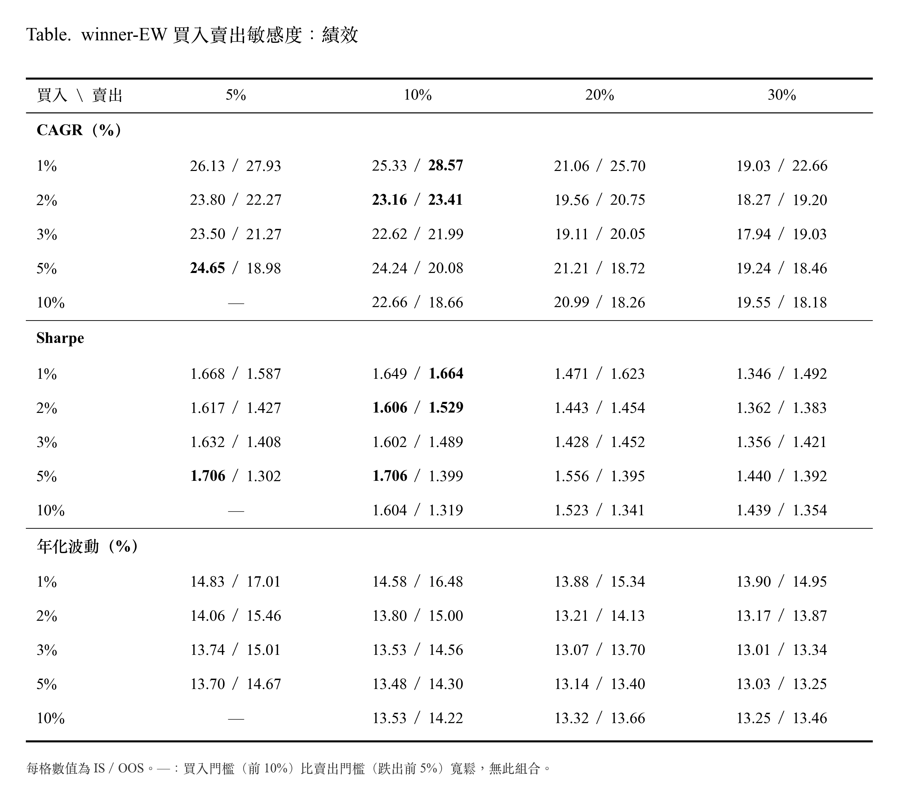
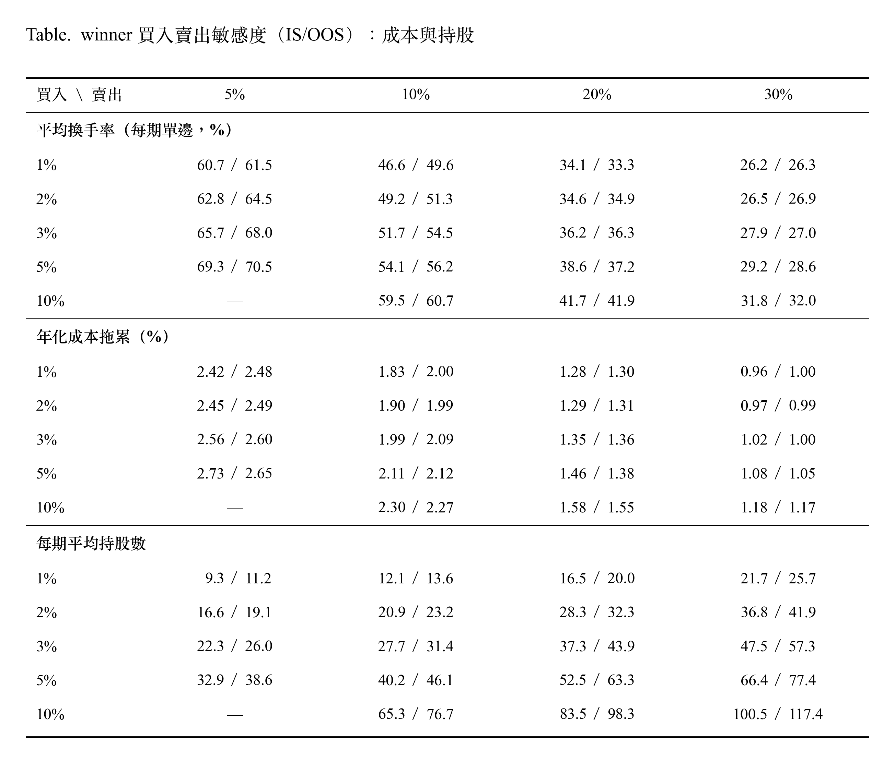

# 策略敏感度調整

## Overview

## 1. 因子敏感度

### 1.1 累積 Rank IC

  

> Rank IC 以下期毛報酬計算（不含交易成本）；E0 與 E1 互為鏡像

#### 解讀
- 多數因子在 OOS 仍有正的預測能力。獲利（A0）、價值（B1）、動能（C0）、風險（D1）等勝者因子，累積 IC 在 OOS 持續上升，但是斜率比 IS 平緩。預測能力減弱，與平均 IC 解讀一致。
- B0 的斜率在 OOS 變陡，PB 出現微弱預測力。
- C1 在兩個期間都幾乎持平，幾乎沒有預測力。
- E0、E1 規模因子在 IS 沒有方向，OOS 轉為大型股較佳。
- **2025 到 2026 年多個因子同時轉弱**（由圖觀察）：殘差 PB（B1）、低 beta（D0）、低波動度（D1）的累積 IC 轉為下降，規模往大型股方向加速。推論，未經驗證：這段期間由大型高市值股主導，與價值、低風險、小型股方向相反。這與策略在 2024 年中以後資金累積持平、股票池落後大盤的解讀一致。準確時間點請見 [5.1 三年窗口滾動多因子曝險分析](03_Backtesting.md#51-三年窗口滾動多因子曝險分析)。

---

### 1.2 因子邊際效益

**從 winner-EW 5 個因子拿掉一個，策略會變好還是變差？**
- 每次拿掉 1 個因子，其餘 4 個仍然排名等權相加

  

#### 推論
- D1 低波動
  - 在 IS 中，多因子 α 幾乎歸零，Sharpe 降到 1.10 且最大回撤加深到 -29.7%。表示低波動是 IS 當中 α 主要來源。
  - 在 OOS 中，雖然 CAGR 有上升比完整版高 (24.62% 對 23.41%)，但是 Sharpe 只有 1.18。表示移除低波動因子，波動大很多，同時最大回撤也降至 34.6%。
  - 表示 D1 的作用在於控制風險，而不是提高報酬。 
- 拿掉 E1 在兩段中每期報酬、CAPM α、多因子 α 都上升，都可以提升績效表現。Sharpe 上升幅度是 6 個版本中最大的(Sharpe IS 1.8, Sharpe OOS 1.74)。
- 換手率拿掉 A0、B1、C0 下降；而拿掉 D1、E1 上升。拿掉任何一個因子，持股重疊只有 53%-69%，因此現在的買賣規則，排名邊界對於因子組成非常敏感，拿掉一個因子就會改變將近一半的持股。

## 2. 買入賣出門檻敏感度

**winner-EW 的績效結果是否隨買入、賣出門檻平滑變化？每期要換手多少股票？每年交易成本吃掉多少報酬？**
- 基準: 2%/10% 為目前實驗設定
- 策略: winner-EW （A0、B1、C0、D1、E1） 五因子排名等權；季換股；持股等權
- 成本: 手續費 0.1425%（雙邊）、證交稅 0.3%（賣出）、滑價 0.1%（雙邊）

  

  

> 每期單邊換手率 =（買進金額 + 賣出金額）÷ 2 ÷ 換股前淨值
>
> 年化成本拖累 = 毛 CAGR - 淨 CAGR ≈ 年化成本 × (1 + 複利/年報酬率)，說明成本讓年化報酬少了多少，可以直接和年化報酬比較

### 解讀
- 換手率、成本拖累，隨著買入門檻調高變大，隨著賣出門檻調高變低。持股數隨買入、賣出門檻調高皆變大。
- 賣出門檻 5% 和 10% 表現差不多（IS 中 5% 報酬表現略好；OOS 中 10% 報酬表現較好）。
- 賣出門檻放寬到 20%、30%，報酬都下降（相對於賣出 10% 門檻，IS 下降 1.7–6.3 個百分點；OOS 下降 0.4-5.9 個百分點）。雖然換手率跟年化成本拖累都較低，但是省下的成本補不回報酬的損失。
  - 賣出緩衝區的作用是降低換手率與成本。但是放寬到 20% 以上時，損失的報酬多於省下的成本。且 5% 與 10% 在兩期間差異不顯著，專案設定維持目前的 10%。
- 買入門檻，報酬在 IS 較不單調無規律。而 OOS 中則隨著買入門檻放寬表現降低 (例如賣出 10% 欄： 28.57%、23.41%、21.99%、20.08%、18.66%)，表現單調遞減。
  - 買入門檻 IS 中看不出規律，但是 OOS 中卻很清楚，最頂端的股票最有效。但同時，1% 因為每期持股數最少（12-14 檔），年化波動較高（IS 14.58%、OOS 16.48%）。
- 在 OOS 中所有格的波動都低於股票池等權（18.4）跟大盤 TRTEJ (19.4)。持股越多波動大致越低。
  - OOS 的波動全部高於 IS，表示 OOS 期間市場波動較大，主要不是門檻與持股差異造成。

## 3. 股票池敏感度

| 組 | 股票池（B1） | 排名與合成 |
|---|---|---|
| U1 | 市值前 30% | 在池內重算 B1、排名、合成（F1） |
| U0 | 市值前 50%（= 實驗一，主規格） | 實驗一 |
| U2 | 市值前 70% | |
| U4 | 流動性前 30% | |
| U3 | 流動性前 50% | 在池內重算（F1） |
| U5 | 流動性前 70% | |  
| U6 U7、U8 | U0 + 均線 30，只限制買入 | 沿用 U0 的排名（F6） |
| U7 | U0 + 均線 60，只限制買入 | |
| U8 | U0 + 均線 120 ，只限制買入| |
| U9、U10、U11 | U0 + 均線 30、60、120 日，限制買入並在換股日賣出跌破均線的持股 | 沿用 U0 的排名（F6） |
| U10 | U0 + 均線 60，限制買入並在換股日賣出跌破均線的持股| |
| U11 | U0 + 均線 120，限制買入並在換股日賣出跌破均線的持股| |

| 組 | 股票池 | CAGR (%) | Sharpe | 年化波動 (%) | 每期平均單邊換手率 (%) | 年化成本拖累 (%) | 每期持股數（中位數） |
|---|---|---|---|---|---|---|---|
| U1 | 市值前 30% | 24.73 / 18.26 | 1.613 / 1.174 | 14.61 / 15.89 | 50.74 / 58.05 | 1.99 / 2.16 | 12 / 13 |
| U0 | 市值前 50% | 23.16 / 23.41 | 1.606 / 1.529 | 13.80 / 15.00 | 49.22 / 51.28 | 1.90 / 1.99 | 21 / 24 |
| U2 | 市值前 70% | 27.72 / 21.10 | 1.870 / 1.482 | 13.83 / 14.06 | 52.97 / 49.84 | 2.13 / 1.89 | 27 / 32 |
| U4 | 流動性前 30% | 26.30 / 17.10 | 1.213 / 0.782 | 21.50 / 24.95 | 70.21 / 75.25 | 2.80 / 2.79 | 10.5 / 12 |
| U3 | 流動性前 50% | 28.33 / 24.88 | 1.504 / 1.185 | 17.95 / 21.38 | 61.98 / 67.01 | 2.51 / 2.64 | 19 / 20 |
| U5 | 流動性前 70% | 31.45 / 25.18 | 1.816 / 1.397 | 16.04 / 17.81 | 57.29 / 58.64 | 2.37 / 2.31 | 26 / 30 |
| U6 | U0 + 均線 30 日，只限制買入 | 23.16 / 23.93 | 1.587 / 1.533 | 13.98 / 15.27 | 50.61 / 52.96 | 1.96 / 2.06 | 21 / 24 |
| U7 | U0 + 均線 60 日，只限制買入 | 23.95 / 24.48 | 1.640 / 1.578 | 13.92 / 15.11 | 49.97 / 51.19 | 1.94 / 2.00 | 21.5 / 24 |
| U8 | U0 + 均線 120 日，只限制買入 | 23.34 / 25.53 | 1.620 / 1.630 | 13.76 / 15.18 | 49.30 / 50.34 | 1.91 / 1.98 | 22 / 24 |
| U9 | U0 + 均線 30 日，限制買入並在換股日賣出跌破均線的持股 | 23.22 / 25.64 | 1.525 / 1.509 | 14.65 / 16.60 | 63.66 / 67.84 | 2.48 / 2.69 | 17 / 19 |
| U10 | U0 + 均線 60 日，限制買入並在換股日賣出跌破均線的持股 | 23.56 / 25.90 | 1.571 / 1.559 | 14.36 / 16.16 | 60.90 / 65.58 | 2.37 / 2.61 | 18 / 20 |
| U11 | U0 + 均線 120 日，限制買入並在換股日賣出跌破均線的持股 | 23.45 / 27.17 | 1.579 / 1.674 | 14.22 / 15.62 | 56.66 / 59.62 | 2.20 / 2.39 | 19 / 21 |

> 每格為 IS / OOS。IS 為第 13–46 期（34 期），OOS 為第 47–81 期（35 期）。CAGR、Sharpe、年化波動皆為扣成本後，由每日淨值計算。
> 策略為含 E1 的 winner-EW（A0、B1、C0、D1、E1），不是現行的 noE1。

## 4. All in One 大禮包

用更多的策略，確認股票池優勢。

說法可以是，只用 IS 結果去調整規則、股票池。 (修表格)
然後股票池就是統一用均線去調整，所以一定是買入賣出一樣。 (修表格)

IS and OOS result
0. 策略: winner-EW / winner-EW-noE1 / winner-EW-noE1-dropB (A0A2 x S_r ) / winner-EW-noE1-dropB (A0A2r x S_r )
1. 買入賣出規則：2%/10%
2. 股票池：市值前 50% / 市值前 70% / 流動性 70% /  市值 70% (60 日均線 + 買入賣出) / 流動性 70% (60 日均線 + 買入賣出)

IS and OOS result
0. 策略: winner-EW / winner-EW-noE1 / winner-EW-noE1-dropB (A0A2 x S_r ) / winner-EW-noE1-dropB (A0A2r x S_r )
1. 買入賣出規則： 1%/10%
2. 股票池：市值前 50% / 市值前 70% / 流動性 70% /  市值 70% (60 日均線 + 買入賣出) / 流動性 70% (60 日均線 + 買入賣出)

