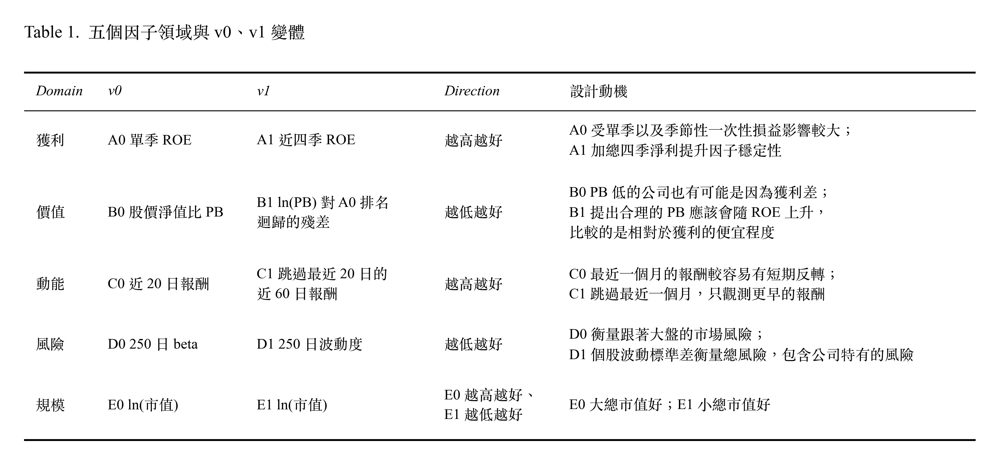

# 台股五因子研究

## 1. Project Overview

以台股 2009 到 2026 年資料，檢驗：
1. **因子變體選擇**：共 5 個領域 (獲利、價值、動能、風險、規模) 每個領域兩個變體。在樣本內（IS）挑出表現較好的因子變體，能否改善樣本外（OOS）的策略績效？
2. **因子合成方式**：用 LightGBM（LGBM）合成因子，能否勝過簡單的等權合成（EW）？

## 2. Process

| 報告 | 內容 |
|---|---|
| [01 Data Acquisition](01_Data_Acquisition.md) | 資料下載、財報日與換股日對齊（PIT）、樣本切分 |
| [02 Single Factor Evaluation](02_Single_Factor_Evaluation.md) | IS 單因子檢定（相關性、Rank IC、十分位 LS、Spanning 迴歸）與勝者選擇 |
| [03 Backtesting](03_Backtesting.md) | 4 個策略的 OOS 回測績效、IS vs OOS 比較、超額報酬拆解、OOS 單因子檢定 |

## 3. Data & Setup

| | |
|---|---|
| 資料 | TEJ TQuant Lab (2005-01-03 到 2026-09-24) |
| 股票池 | 上市櫃普通股，每期市值前 50%（約 575–850 檔） |
| 換股 | 季頻，財報法定期限（03/31、05/15、08/14、11/14）後的第一個交易日 |
| 樣本切分 | 暖機期 2006-04 到 2009-04；IS 2009-05 到 2017-08（34 期）；OOS 2017-11 到 2026-05（35 期） |
| 因子 | 5 個領域（獲利、價值、動能、風險、規模）：每領域 v0、v1 兩個變體 |
| 合成 | 2 種合成方式：等權合成 (EW)、LightGBM (LGBM) |
| 策略 | 只做多，買進綜合排名前 2%、跌出前 10% 賣出，持股等權 |
| 成本 | 手續費 0.1425%（雙邊）、證交稅 0.3%（賣出）、滑價 0.1%（雙邊） |

## 4. Factors

## 5. Result & Future Work

| OOS | v0-EW | winner-EW | v0-LGBM | winner-LGBM | 股票池等權 | TRTEJ |
|---|---|---|---|---|---|---|
| 年化報酬 | 20.7% | 23.4% | 23.2% | 23.0% | 14.6% | 21.3% |
| Sharpe | 1.30 | 1.53 | 1.49 | 1.53 | 0.86 | 1.13 |
| 最大回撤 | −29.5% | −29.3% | −26.1% | −25.6% | −32.4% | −29.6% |

- 因子變體選擇、因子合成方式在樣本沒有顯著差異。
- 沒有 IS 勝者選擇過度擬合的證據：winner-EW 在 IS 沒有勝過 v0-EW，在 OOS 反而略好。
- **OOS 時期策略表現強，但相對大盤大致持平**：OOS 年化報酬 20.7%–23.4%、Sharpe 1.30–1.53，大盤 TRTEJ 同期為 21.3%、1.13。選股優勢仍為正，但等權股票池在 OOS 落後大盤，兩者幾乎抵銷策略優勢。

### 未來研究
- 檢驗 OOS 期間大型權值股主導市場的推論。例如: 以「股票池市值加權」拆解股票池落後大盤的結構原因。
- 分析各因子的市場曝險與年度表現，釐清因子何時失效。
- 因子貢獻：逐一拿掉單一因子的策略回測，衡量各因子的邊際貢獻。