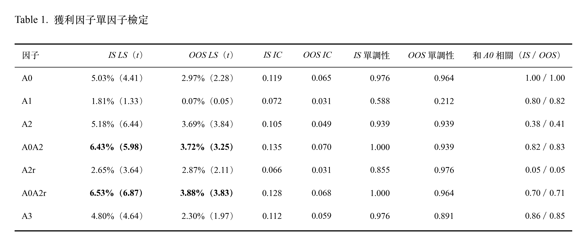

# 01_新策略調整

## Overview
根據 winner-EW-noE1 使用的因子 （獲利 A0, 價值 B1, 動能 C0, 風險 D1）進一步嘗試其餘因子，組成新的策略測試報酬。

## 新因子設計

### 獲利設計

| 代號 | 類型 | 公式 |
|---|---|---|
| A0 | 單一因子（水準） | 單季 ROE。單季歸屬母公司淨利（a3950）÷ 該季期末股東權益（a200e） |
| A1 | 單一因子（水準） | 近四季 ROE。近四季歸屬母公司淨利加總 ÷ 最新一季期末股東權益（四季同一報表基礎） |
| A2 | 單一因子（變化） | 單季 ROE 年增（本季 - 去年同季）。單季 ROE_P − 單季 ROE_{P−4}（P 同 A0；P−4 為同一報表基礎、T−1 已公告的最新版本） |
| A3 | 單一因子（水準） | 單季營業利益（a3395）÷ 該季期末資產總額（a0010），使用和 A0 完全相同的財報列 |
| A0A2 | 合成 | A0 與 A2 百分位排名平均。rank_average(A0, A2) |
| A2r | 單因子 | A0 對 A2 回歸後的排名殘差。每期對 A0、A2 都有值的股票做 OLS（含截距）：pct(A2) = a + b × pct(A0) + e；A2r = e |
| A0A2r | 合成 | A0 與 A2 的百分位排名平均。rank_average(A0, A2r) |

> 方向：全部越高越好。
> pct：在股票池內排名（同值取平均排名）÷ 股數。
> rank_average：各成分只在所有成分都有值的股票中計算 pct，再取平均。
> 缺值：分母 ≤ 0 或任一輸入缺值時為缺值；合成與殘差因子在任一成分缺值時為缺值。
> A2r 的殘差計算沿用 B1 的函式（`ols_residuals_lstsq`）。
> A2r、A0A2r 是看過 A2 的 IS 與 OOS 結果後才提出的，只作描述。

---

### 價值 M16

B2　控制獲利水準與改善之後的便宜程度（越低越好），每個再平衡日，在選股池內做橫斷面迴歸：

$$\ln(\text{PB}_i) = a + b_1 \cdot \text{pct}(\text{A0}_i) + b_2 \cdot \text{pct}(\text{A2}_i) + \varepsilon_i, \quad \text{B2}_i = \varepsilon_i$$

PB = T−1 總市值 ÷ 母公司股東權益；pct 為百分位排名。

金融意義：以公司目前的獲利水準（A0）和獲利改善幅度（A2）而言，股價還有多便宜。殘差越低，代表扣除這兩項基本面能解釋的估值後仍然便宜。
設計理由：B1 只控制 A0，A 位置換成 A0A2 後兩者不再配對；B2 控制同一組資訊，恢復「A 負責好、B 負責以這個好而言便宜」的分工。A 位置用 A0A2 或 A0A2r 時，B2 的殘差相同。

---

### 動能

| 期間 | 報酬 | 報酬 + 為正天數 | 報酬 + 低週轉 | 為正天數 + 低週轉 | 報酬 + 為正天數 + 低週轉 |
|---|---|---|---|---|---|
| S (T−21, T−1]，20 日 | S_r（= C0） | S_r_pos | S_r_lt | S_pos_lt | S_r_pos_lt |
| M (T−61, T−21]，40 日（跳過近 20 日） | M_r（= C1） | M_r_pos | M_r_lt | M_pos_lt | M_r_pos_lt |
| L (T−252, T−21]，231 日（跳過近 20 日） | L_r | L_r_pos | L_r_lt | L_pos_lt | L_r_pos_lt |

> r：日報酬連乘 − 1
> pos：報酬 > 0 天數 ÷ 有效交易日數（停牌日不計）
> lt：有效日平均週轉率，越低越好（停牌日不計）
> 多元素因子：各元素在所有元素都有值的股票中排名（同值取平均排名），換算成百分位後取平均

## Single Factor Evaluation

### 獲利因子

**改良的獲利因子在單因子層檢定中，報酬、預測力有沒有比 A0 單季 ROE 好？**

  

#### 解讀
- 最好的是 A0A2r > A0A2 > A2 > A0
- A2 的 LS 很高，但是 
  - A2 的 LS 和 A0 差不多，但是 t 卻高很多。代表 A2 的每期 LS 波動較小，報酬較穩定。
  - IC 比較弱一點 (IS 0.105, OOS 0.049)，表示預測力集中在兩端，中間排序較弱。
- A1 幾乎沒有預測力

---

### 價值因子 M16

---

### 動能因子

| 期間 | 報酬 | 報酬 + 為正天數 | 報酬 + 為正天數 + 低週轉 |
|---|---|---|---|
| S (T−21, T−1]，20 日 | S_r（= C0） | S_r_pos  | S_r_pos_lt |
| M (T−61, T−21]，40 日（跳過近 20 日） | M_r（= C1） | M_r_pos  | M_r_pos_lt |
| L (T−252, T−21]，231 日（跳過近 20 日） | L_r | L_r_pos | L_r_pos_lt |

**LS 每期平均（HAC t），IS → OOS**

| 期間 | 報酬 | 報酬 + 為正天數 | 報酬 + 為正天數 + 低週轉 |
|---|---|---|---|
| S (T−21, T−1]，20 日 | S_r：2.44%（2.35）→ 3.86%（3.16） | S_r_pos：3.39%（3.51）→ 4.47%（3.51） | S_r_pos_lt：3.79%（4.15）→ 1.22%（0.89） |
| M (T−61, T−21]，40 日（跳過近 20 日） | M_r：1.53%（1.53）→ 2.23%（1.35） | M_r_pos：2.13%（2.43）→ 3.83%（1.91） | M_r_pos_lt：3.75%（3.48）→ 1.49%（1.47） |
| L (T−252, T−21]，231 日（跳過近 20 日） | L_r：2.62%（2.21）→ 1.77%（1.18） | L_r_pos：1.81%（1.83）→ 3.62%（1.87） | L_r_pos_lt：3.67%（2.92）→ 3.26%（2.52） |

**IC 平均，IS → OOS**

| 期間 | 報酬 | 報酬 + 為正天數 | 報酬 + 為正天數 + 低週轉 |
|---|---|---|---|
| S | 0.050 → 0.047 | 0.058 → 0.047 | 0.095 → 0.073 |
| M | 0.021 → 0.001 | 0.023 → 0.014 | 0.071 → 0.048 |
| L | 0.051 → −0.007 | 0.040 → 0.004 | 0.095 → 0.047 |

**和 D1（低波動）的排名相關中位數，IS → OOS**

| 期間 | 報酬 | 報酬 + 為正天數 | 報酬 + 為正天數 + 低週轉 |
|---|---|---|---|
| S | 0.11 → 0.11 | 0.03 → −0.01 | 0.33 → 0.36 |
| M | −0.04 → −0.18 | −0.07 → −0.17 | 0.27 → 0.24 |
| L | −0.15 → −0.35 | −0.26 → −0.39 | 0.14 → 0.05 |

#### 解讀
- S_r, S_r_pos, L_r_pos_lt
  - 兩段的 LS 的 t 都 > 2
  - IC 較高 (OOS > 0.47)
  - 和 D1 重疊低 (兩段絕對值 ≤ 0.15 )

