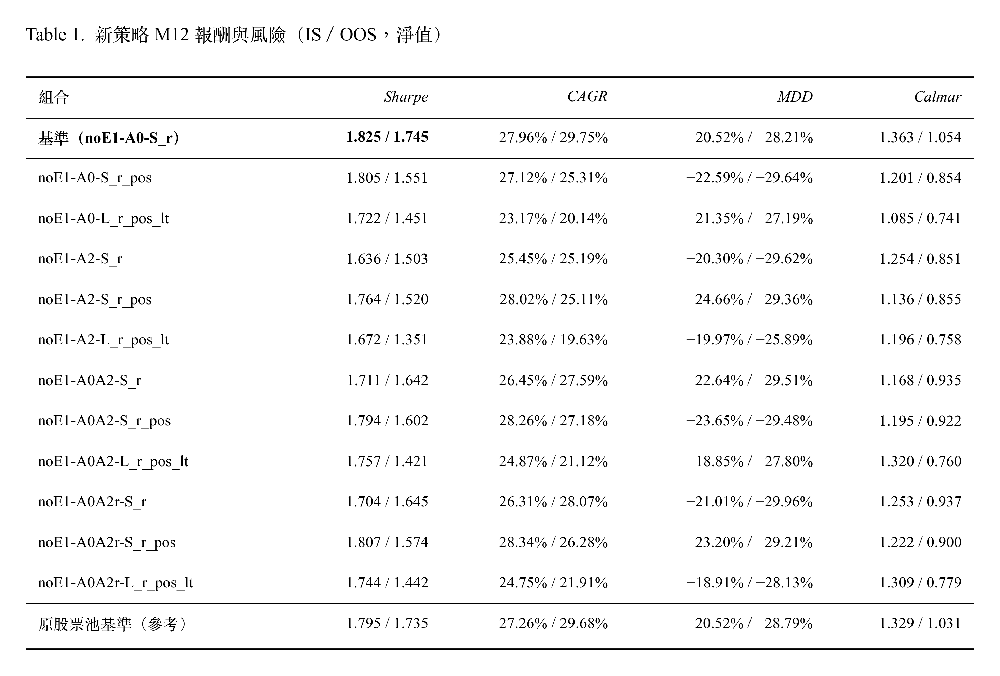

# 02_Strategy Backtesting

## 新策略 M12

winner-EW-noE1 (A0, B1, C0, D1)
**把 winner-EW-noE1 的 A、C 兩個位置換成 A x C 新因子，策略的風險調整報酬會不會更好？**

  

####  解讀
- 基準在 IS 和 OOS 都是 Sharpe 最高的組合。
- IS 中只有 3 個候選的每期差為正（都是 C = S_r_pos，+0.05% 到 +0.11%）；OOS 中 11 個全部為負。
- 只換 A 位置（C = S_r）的 3 個候選，兩段的每期差都為負（IS −0.29% 到 −0.53%；OOS −0.41% 到 −1.06%）。
- C = L_r_pos_lt 的 4 個候選：兩段的換手率都降到 40%–45%（基準約 60%），成本拖累降到約 1.6 個百分點（基準約 2.4–2.6），波動也較低；但 CAGR 低於基準約 3–5 個百分點（IS）與 8–10 個百分點（OOS）。
- noE1-A0A2-L_r_pos_lt 的 IS MDD 最淺（−18.85%），OOS 不是。
- 原股票池基準和交集版基準只差在股票池，Sharpe 差 0.029（IS）、0.009（OOS）。
- M11 因子層的優勢沒有轉移到策略層。 可能原因：(1) 策略只買前 2%，十分位 LS 衡量的是整個排序；(2) 4 個因子合成後，換掉一個位置會改變它和 B1、D1 的搭配，持股組成也大幅改變。
- L_r_pos_lt 的作用比較像防禦型傾斜：它和 D1 的排名相關高（M11），加入後大致等於加重低波動的權重，所以換手、成本、波動都下降，報酬也下降。OOS 的降幅更大，可能和 OOS 期間大盤上漲較強有關。
- 候選之間的小差距多半是雜訊：只改變不到 1% 的股票池，Sharpe 就差 0.03（R3）；IS 中為正的 3 個候選，差距都在這個範圍內，而且 OOS 全部轉負。
- 至少在這批候選中，現行的 A0、C0 組合沒有被改良。

-----

## 因子數分析 M13

**winner-EW-noE1 的 4 個因子中，每個因子的邊際效益是多少？拿掉它，策略會變好還是變差？**

**報酬與風險（IS／OOS，淨值）**

| 版本 | Sharpe | CAGR | 年化波動 | MDD | Calmar |
|---|---|---|---|---|---|
| **基準** | 1.795／**1.735** | 27.26%／29.68% | 14.23%／16.30% | −20.52%／−28.79% | 1.329／1.031 |
| noE1-dropA | 1.541／1.391 | 21.55%／19.34% | 13.48%／13.87% | −21.27%／−25.34% | 1.013／0.763 |
| noE1-dropB | **2.049**／1.655 | 26.89%／21.77% | 12.20%／12.84% | −17.26%／−24.61% | 1.558／0.885 |
| noE1-dropC | 1.711／1.454 | 23.08%／20.30% | 12.84%／13.84% | −24.80%／−28.72% | 0.931／0.707 |
| noE1-dropD | 1.263／1.168 | 23.83%／25.56% | 18.61%／22.37% | −31.09%／−35.12% | 0.767／0.728 |

#### 解讀
- OOS 中，4 個 drop 版本的 Sharpe 都低於基準，每期差都為負。IS 中 4 個每期差也都為負，但 dropB 的 Sharpe 高於基準。
- 拿掉 A0：兩段的 CAGR 都下降最多之一（IS −5.7、OOS −10.3 個百分點）；OOS Holm p 0.029。
- 拿掉 C0：兩段的每期差都為負（IS −0.84%、OOS −2.11%）；OOS Holm p 0.020；IS 的 MDD 加深到 −24.80%。
- 拿掉 D1：兩段的波動（18.61%、22.37%）與 MDD（−31.09%、−35.12%）都是 5 個版本中最差的，換手率也最高（約 68%）；每期報酬差在兩段都不大（−0.57%、−0.67%）。
- 拿掉 B1：IS 的波動、MDD、Sharpe 都優於基準，報酬幾乎相同（每期差 −0.09%）；OOS 的每期差擴大到 −1.85%，Sharpe 低於基準。它和基準的持股重疊在兩段都是最低的（0.34、0.38）。
- 拿掉 A0、B1、C0 任一個時，兩段的波動都低於基準，換手率也較低。

---

## 三因子 + A x C 效果 M14

**三因子策略 (A, C, D)，A、C 位置換成新因子，能不能勝過 A0、C0？**

| 組合 | Sharpe | CAGR | MDD | Calmar |
|---|---|---|---|---|
| **基準（dropB-A0-S_r）** | 2.063／1.649 | 27.12%／21.63% | −17.26%／−24.61% | 1.571／0.879 |
| dropB-A0-S_r_pos | 2.142／1.545 | 28.39%／21.28% | −17.24%／−27.47% | 1.646／0.775 |
| dropB-A0-L_r_pos_lt | 1.852／1.647 | 22.15%／20.72% | −22.84%／−23.26% | 0.970／0.891 |
| dropB-A2-S_r | 1.884／1.606 | 28.43%／25.19% | −22.60%／−26.46% | 1.258／0.952 |
| dropB-A2-S_r_pos | 1.905／1.513 | 28.24%／22.18% | −20.22%／−27.02% | 1.397／0.821 |
| dropB-A2-L_r_pos_lt | 1.816／1.574 | 22.66%／21.57% | −18.87%／−23.87% | 1.201／0.904 |
| dropB-A0A2-S_r | 2.137／**1.745** | 29.97%／25.97% | −17.88%／−26.55% | 1.676／0.978 |
| dropB-A0A2-S_r_pos | **2.189**／1.594 | 30.92%／22.80% | −17.73%／−27.97% | 1.743／0.815 |
| dropB-A0A2-L_r_pos_lt | 1.962／1.610 | 24.17%／21.20% | −18.58%／−24.38% | 1.301／0.870 |
| dropB-A0A2r-S_r | 2.128／1.711 | 30.13%／26.26% | −19.69%／−26.36% | 1.531／0.996 |
| dropB-A0A2r-S_r_pos | 2.104／1.625 | 30.55%／23.42% | −17.98%／−25.91% | 1.700／0.904 |
| dropB-A0A2r-L_r_pos_lt | 1.902／1.616 | 23.93%／21.84% | −18.91%／−23.84% | 1.265／0.916 |
| 原股票池基準（參考） | 2.049／1.655 | 26.89%／21.77% | −17.26%／−24.61% | 1.558／0.885 |

| 策略 | 因子 | Sharpe（IS／OOS） | CAGR（IS／OOS） | MDD（IS／OOS） | 年化波動（IS／OOS） |
|---|---|---|---|---|---|
| winner-EW（原股票池） | A0、B1、C0、D1、E1 | 1.606／1.529 | 23.16%／23.41% | −23.51%／−29.34% | 13.80%／15.00% |
| winner-EW-noE1（原股票池） | A0、B1、C0、D1 | 1.795／1.735 | 27.26%／29.68% | −20.52%／−28.79% | 14.23%／16.30% |
| winner-EW-noE1（交集） | A0、B1、C0、D1 | 1.825／1.745 | 27.96%／29.75% | −20.52%／−28.21% | 14.32%／16.24% |
| dropB（交集） | A0、C0、D1 | 2.063／1.649 | 27.12%／21.63% | −17.26%／−24.61% | 12.20%／12.81% |
| dropB-A2-S_r（交集） | A2、C0、D1 | 1.884／1.606 | 28.43%／25.19% | −22.60%／−26.46% | 14.04%／15.23% |
| dropB-A0A2-S_r（交集） | A0A2、C0、D1 | 2.137／1.745 | 29.97%／25.97% | −17.88%／−26.55% | 12.87%／14.30% |
| dropB-A0A2r-S_r（交集） | A0A2r、C0、D1 | 2.128／1.711 | 30.13%／26.26% | −19.69%／−26.36% | 12.99%／14.77% |

#### 解讀

**數字顯示的事實**

- 相對 dropB 基準，C = S_r 或 S_r_pos 的候選中，有 6 個在兩段的每期差都為正（A0-S_r_pos 的 OOS 為 −0.07%）；OOS 差距最大的是 A0A2r-S_r（+1.02%）、A0A2-S_r（+0.97%）、A2-S_r（+0.86%）。
- 11 個候選在 M12 中，有 8 個的 IS 每期差為負、OOS 全部為負；在 M14 中，C 不是 L_r_pos_lt 的 8 個候選 IS 全部為正，OOS 有 7 個為正。
- 沒有任何 M14 組合在 OOS 的 CAGR 超過 noE1；dropB-A0A2-S_r 的 OOS Sharpe 和 noE1（交集）相同（1.745）。
- dropB 系列的 OOS 波動（12.3%–15.2%）都低於 noE1（16.2%），OOS MDD 也都較淺。
- C = L_r_pos_lt 的 4 個候選，IS 每期差為 −0.61% 到 −1.05%，OOS 為 −0.01% 到 −0.27%；換手率 26%–43%，是所有組合中最低的。
- 所有 M14 組合的 IS Sharpe（1.82–2.19）都高於 M12 的 12 個組合（1.64–1.83）。

**推論，未經驗證**

- **B1 的搭配**：A0A2 的頂端優勢（M12 D1：單因子前 2% 每期多 1.99%）在含 B1 的 4 因子合成中被抵銷，拿掉 B1 後才保留下來。可能原因是 B1 的定義是「控制 A0 之後的便宜程度」，和 A0 成對設計，和 A0A2 不對齊。
- **拿掉 B1 的代價比 A0A2 的改善更大**：dropB 基準在 OOS 比 noE1 每年少約 8 個百分點，A0A2 只補回約 4 個百分點。在報酬上，現行的 noE1 仍然最好。
- dropB-A0A2-S_r 的特性是「Sharpe 相近、波動與回撤較低、報酬較低」，比較像用 A2 的資訊取代 B1，換到一個比較防禦的組合。
- M14 所有組合的 IS Sharpe 偏高，可能有一部分來自 dropB 在 IS 期間的整體優勢；M13 已經顯示 dropB 的 IS 優勢在 OOS 不成立。
- 從 11 個候選中看最好的，本來就會高估；M14 的設計與基準又來自已看過的結果。

-----

## 新價值策略 M17

**把 winner-EW-noE1 ，改成新的價值因子 B2，測試 A x C 新因子，策略的風險調整報酬會不會更好？**
- winner-EW-noE1-newB2 (A, B2, C, D1)

--- 

